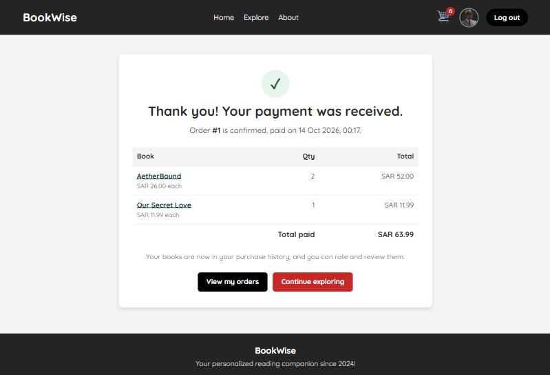
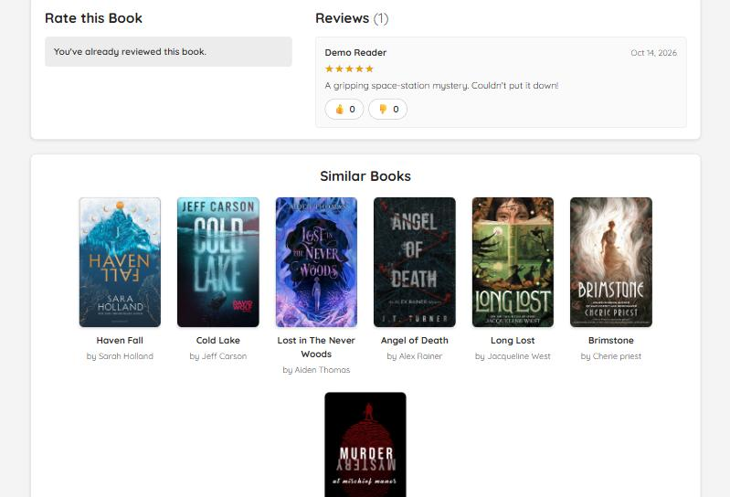
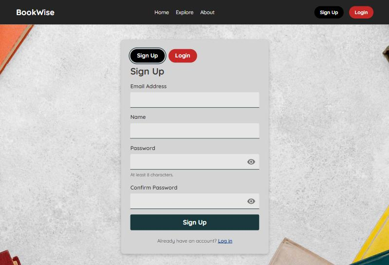

# BookWise — Online Book Store

[](https://github.com/ByAhmd/Online-BookStore-Project/actions/workflows/ci.yml)
[](LICENSE)

BookWise is an online bookstore written in plain PHP with MySQL/MariaDB.
Customers browse a catalog, search and filter by genre, keep favorites, buy books
through **Stripe Checkout** (or the built-in **payment simulator**) and review the books
they bought. Administrators manage the catalog, stock and covers, follow orders and
refund them. The whole interface is available in **English and Arabic** (right-to-left).

It runs locally with PHP's built-in server or Docker, and can be published as a free
**live demo** with simulated payments on ordinary PHP hosting such as alwaysdata
(see [docs/DEPLOYMENT.md](docs/DEPLOYMENT.md)).

It started as a team project for the *Fundamentals of Web Programming* course at
King Faisal University (see the in-app **About** page). It has since been audited
and partly rewritten for security, correctness and maintainability. The plain-PHP
page architecture is unchanged; there is no framework.

---

## Contents

- [Features](#features)
- [Technology stack](#technology-stack)
- [Project structure](#project-structure)
- [Getting started](#getting-started)
- [Running with Docker and the live demo](#running-with-docker-and-the-live-demo)
- [Configuration reference](#configuration-reference)
- [Languages](#languages)
- [Payments: the simulator and Stripe](#payments-the-simulator-and-stripe)
- [Email](#email)
- [Database migrations](#database-migrations)
- [Upgrading a database from the original project](#upgrading-a-database-from-the-original-project)
- [Testing and quality checks](#testing-and-quality-checks)
- [Security notes](#security-notes)
- [Deployment checklist](#deployment-checklist)
- [Known limitations](#known-limitations)
- [Screenshots](#screenshots)
- [License](#license)

---

## Features

**Customers**
- Sign up, log in and log out. Passwords are hashed with `password_hash()`, failed logins are throttled, and the session ID is regenerated on login.
- Email verification: new accounts confirm their address through a link that expires after 24 hours (can be turned off with `REQUIRE_EMAIL_VERIFICATION=false`).
  The link asks for the account's password before it confirms and signs in, so mail scanners that open links, or someone who registered another person's address, cannot use it.
  Signing up with an address that is already registered sends a notice to that address instead of revealing the account on screen.
- Password reset by email, using single-use links that expire after 60 minutes.
- Home page with the real catalog size, genre shortcuts, recommended books (by rating) and best sellers (by sales).
- Explore page:
  - Search by title or author.
  - Genre tabs generated from the catalog, plus **Favorites**.
  - 24 books per page with page links.
  - Works without JavaScript; with JavaScript, results update in place.
- Book pages:
  - Description, price, average rating, copies sold and stock ("Only 3 left", "Out of stock").
  - Add to cart with a quantity, and add to or remove from favorites.
  - Reviews with a 1–5 star rating, only for customers who bought the book and only once per book. Other readers can like or dislike a review.
- Cart: change quantities (1–10 per title, never more than in stock), remove items, and see totals computed from catalog prices on the server.
- Checkout on Stripe's hosted payment page, or on the built-in payment simulator's page. An order is confirmed only after BookWise has verified the payment.
- Profile:
  - Name, favorite genre, date of birth and profile picture (JPEG/PNG/GIF/WebP, max 2 MB, re-encoded on upload).
  - A payment-method *preference* (no card data is ever stored).
  - Order history with status, including refunds.
  - Interface language (English or Arabic), remembered on the account.
  - Change password (signs out every other session) and delete the account (asks for the password; past orders are kept anonymously for the store's records).

**Administrators**
- Add, edit and delete books, with server-side validation, stock levels and cover uploads (JPEG/PNG/GIF/WebP, max 5 MB, re-encoded).
- Dashboard with catalog and sales totals, stock per book and the 20 most recent orders.
- Orders page: filter by status, search by order number or customer email, and open any order.
  A paid order can be refunded in full through Stripe from its page; the copies go back into stock.
  Refunds made in the Stripe Dashboard are picked up by the `charge.refunded` webhook.
- Accounts are created from the command line (`bin/create-admin.php`, or `bin/install.php` in containers); there is no public admin sign-up.

**Everywhere**
- English and Arabic interface with a language switch in the header, Arabic plural forms, Arabic dates, amounts and genre names, and a mirrored right-to-left layout.
- Optional demo mode (`APP_DEMO=true`) for a public showcase: a banner, a built-in payment simulator instead of Stripe, and optionally a demo inbox that shows the store's emails instead of sending them.
  The simulator runs inside the application, so no Stripe account, second server or special web-server setup is needed.

## Technology stack

| Layer | Technology |
| --- | --- |
| Language | PHP ≥ 8.1 (tested on 8.2 and 8.4; CI covers 8.1–8.4) |
| Database | MySQL ≥ 8.0.16 or MariaDB ≥ 10.4 (InnoDB, utf8mb4), accessed with PDO prepared statements |
| Payments | [Stripe Checkout](https://stripe.com/docs/payments/checkout) via `stripe/stripe-php` 16.x, or the built-in payment simulator |
| Email | Any SMTP server through PHPMailer (`phpmailer/phpmailer` 7.x), a demo inbox stored in the database, or a local log file for development |
| Frontend | Server-rendered HTML, plain CSS and vanilla JavaScript (no build step), Google Fonts (Quicksand) |
| Tooling | Composer, PHPUnit 10, PHPStan 2 (level 6), GitHub Actions |

Required PHP extensions: `pdo_mysql`, `mbstring`, `curl`, `json`, `fileinfo`.
`gd` is recommended (it re-encodes uploaded avatars, which strips metadata and embedded payloads).
`openssl` is needed to send email over SMTP with TLS.

## Project structure

```
.
├── public/                 Web root: point your server's document root here
│   ├── *.php               Pages and form handlers (index.php = login/sign-up, Home_Page.php, Explore_Page.php,
│   │                       pay.php = the payment simulator's page, …)
│   ├── css/  js/           Stylesheets and scripts (common.css/common.js are shared)
│   ├── imges/              Catalog covers and UI images (folder name kept: database rows reference it)
│   └── uploads/            Uploaded avatars/ and covers/ (git-ignored, must be writable)
├── src/                    Shared PHP code (autoloaded by Composer)
│   ├── bootstrap.php       Loaded by every page: config, error handling, session, security headers, language
│   ├── auth.php users.php password_reset.php csrf.php validation.php
│   ├── books.php cart.php orders.php   Catalog, stock, cart, Stripe orders and refunds
│   ├── payment_simulator.php           Built-in stand-in for the Stripe API (demo payments)
│   ├── i18n.php            Translations (t(), tn()), Arabic plurals, language switching
│   ├── migrations.php      Schema migration runner
│   ├── db.php env.php helpers.php mailer.php uploads.php
│   └── views/              Shared header (navigation), footer and error page
├── lang/en/  lang/ar/      Interface text, one file per area (common, auth, account, shop, admin, mail)
├── database/
│   ├── schema.sql          Latest database schema (fresh installs)
│   ├── seed.sql            Sample catalog: 55 books with stock, no user data
│   └── migrations/         Changes applied to existing databases, in order
├── bin/
│   ├── setup.php           Set up a demo on PHP hosting without Docker (.env, database, administrator)
│   ├── install.php         Create the schema on an empty database, or migrate an existing one
│   ├── migrate.php         Apply pending migrations
│   ├── create-admin.php    Create an administrator or reset an administrator's password
│   ├── upgrade-legacy-db.php  Upgrade a database created by the original project
│   └── lint.php            `php -l` over the whole project
├── docker/  Dockerfile  docker-compose.yml   Container image and local Compose setup
├── docs/                   DEPLOYMENT.md (Docker, alwaysdata demo, Tailscale Funnel), AUDIT.md (audit record), screenshots/
├── storage/                logs/ (app.log, php-error.log, mail.log) and the payment simulator's state (git-ignored)
├── tests/                  PHPUnit suites (unit, integration, http, deploy) and an HTTP wrapper around the payment simulator
├── .env.example            Configuration template
└── .github/workflows/ci.yml
```

Only `public/` should be served to browsers; `.env`, `vendor/`, `src/` and the logs live outside it.
This holds when the web server's document root (or alias) is `public/`, as described below.
As a safety net for Apache setups that serve the whole folder, the root `.htaccess` denies everything except `public/`.

## Getting started

### 1. Prerequisites

- PHP 8.1+ with the extensions listed above, and [Composer](https://getcomposer.org/)
- MySQL 8.0.16+ or MariaDB 10.4+ (XAMPP, Laragon, DBngin, Docker, a system service and so on)
- Optional: a free [Stripe](https://dashboard.stripe.com/register) account in **test mode**. Without one, checkout uses the built-in [payment simulator](#payments-the-simulator-and-stripe).

### 2. Install dependencies

```bash
git clone https://github.com/ByAhmd/Online-BookStore-Project.git bookwise
cd bookwise
composer install
```

### 3. Create the database

```sql
CREATE DATABASE bookwise CHARACTER SET utf8mb4 COLLATE utf8mb4_unicode_ci;
CREATE USER 'bookwise'@'localhost' IDENTIFIED BY 'choose-a-password';
GRANT SELECT, INSERT, UPDATE, DELETE ON bookwise.* TO 'bookwise'@'localhost';
```

### 4. Configure the environment

```bash
cp .env.example .env
```

Edit `.env`: set the `DB_*` values and `APP_URL`. See the [configuration reference](#configuration-reference).
For payments, either set `PAYMENT_SIMULATOR=true` (or `APP_DEMO=true`, which also turns it on) to use the built-in payment simulator,
or set your Stripe **test** keys.
For local development you can set `REQUIRE_EMAIL_VERIFICATION=false`, or open the verification links from `storage/logs/mail.log`.

Then create the tables and, with `--seed`, the sample catalog:

```bash
php bin/install.php --seed
```

This needs a database account that may create tables (`CREATE, ALTER, INDEX, REFERENCES, DROP` on the database).
Either run it once with an administrative account in the environment, for example `DB_USER=root DB_PASS=... php bin/install.php --seed`, or grant those rights to the application user.
On an existing BookWise database the same command applies pending [migrations](#database-migrations) instead.

You can also import the SQL files by hand: `mysql -u root -p bookwise < database/schema.sql`, then `database/seed.sql`
(on Windows PowerShell run them through `cmd /c "..."`, or use phpMyAdmin → *Import*, in that order).

### 5. Create an administrator

```bash
php bin/create-admin.php admin@example.com "Store Admin"
```

You will be prompted for a password (minimum 8 characters). To script it, set
`BOOKWISE_ADMIN_PASSWORD` in the environment instead.

Running the command again for the same email resets that administrator's password.
It also signs out the administrator's other sessions and clears any sign-in lockout.

### 6. Run it

**PHP built-in server (simplest):**

```bash
php -S localhost:8000 -t public
```

Open <http://localhost:8000>. With this option, set `APP_URL=http://localhost:8000`.
With the payment simulator on, this one server is all you need to buy a book: checkout opens the simulated payment page `pay.php` on the same server.

**XAMPP / Apache:** keep the project *outside* `htdocs` and expose only `public/` with an alias.
Add this to `C:\xampp\apache\conf\extra\httpd-xampp.conf`, or to the end of `httpd.conf`, then restart Apache:

```apache
Alias /bookwise "C:/path/to/bookwise/public"
<Directory "C:/path/to/bookwise/public">
    AllowOverride All
    Require all granted
</Directory>
```

Open `http://localhost/bookwise/`. With this option, set `APP_URL=http://localhost/bookwise`.
In production, point the virtual host's `DocumentRoot` at `public/`.

> If you do copy the whole project into `htdocs`, Apache still serves only `public/`.
> The project-root `.htaccess` denies everything else (`.env`, `storage/logs`, `vendor/`, `src/` and so on), and `public/.htaccess` re-allows the web root.
> This relies on `AllowOverride All`, which is XAMPP's default.
> Servers that ignore `.htaccess` files (nginx, `php -S`) must use `public/` as the document root.

Customers register through the **Sign Up** button. Administrators log in on the same form.

## Running with Docker and the live demo

The repository includes a production-style image (PHP 8.3 + Apache, serving only `public/`) and a Compose setup with MySQL:

```bash
docker compose up --build
```

Open <http://localhost:8080>. The container creates or migrates the database on start-up, loads the sample catalog and runs in demo mode, with payments simulated instead of sent to Stripe.
In demo mode the stock is topped up at every start and simulated purchases never take a book below 3 copies, so visitors cannot sell the shared catalog out.

[docs/DEPLOYMENT.md](docs/DEPLOYMENT.md) explains the image and:

- how to publish a free public demo on **alwaysdata** (ordinary PHP hosting with MariaDB, no Docker), step by step, with the setup script `php bin/setup.php`;
- how to present the Docker store from your own PC through **Tailscale Funnel**;
- how to switch from demo mode to real Stripe payments and email.

## Configuration reference

All settings come from environment variables. `src/env.php` loads `.env` for
convenience, and variables already set in the real environment take precedence.

| Variable | Default | Description |
| --- | --- | --- |
| `APP_NAME` | `BookWise` | Name shown in page titles, the navigation bar and the footer |
| `APP_ENV` | `production` | `local`, `testing` or `production`. Live Stripe keys are refused unless this is `production`. |
| `APP_DEBUG` | `false` | Show exception details in the browser. **Never enable in production.** |
| `APP_URL` | `http://localhost:8000` | Public URL of `public/` without a trailing slash. Used for Stripe return URLs and password-reset links. |
| `APP_TIMEZONE` | `Asia/Riyadh` | PHP and database-session timezone |
| `APP_DEFAULT_LOCALE` | `en` | Interface language for visitors who have not chosen one: `en` or `ar` |
| `APP_DEMO` | `false` | Public demo mode: shows a banner, turns the payment simulator on (unless `PAYMENT_SIMULATOR=false`) and keeps the sample catalog in stock ([docs/DEPLOYMENT.md](docs/DEPLOYMENT.md)). Required for the demo inbox (`MAIL_DRIVER=database`). |
| `REQUIRE_EMAIL_VERIFICATION` | `true` | New customers must confirm their email address before signing in. Needs working email in production. |
| `LOG_DIR` | `storage/logs` | Directory for `app.log`, `php-error.log` and `mail.log` (relative paths start at the project root) |
| `DB_HOST` / `DB_PORT` | `127.0.0.1` / `3306` | Database server |
| `DB_NAME` | `bookwise` | Database name |
| `DB_USER` / `DB_PASS` | `root` / *(empty)* | Database credentials |
| `DB_SSL_CA` / `DB_SSL_CA_PEM` | — | TLS for hosted databases: path to the CA certificate, or the certificate text itself. The server certificate is then verified. |
| `PAYMENT_SIMULATOR` | follows `APP_DEMO` | `true`: payments go to the built-in [payment simulator](#payments-the-simulator-and-stripe) instead of Stripe; `false`: always Stripe |
| `PAYMENT_SIMULATOR_STORE` | `storage/payment-simulator.json` | The simulator's state file (relative paths start at the project root); must be writable |
| `STRIPE_SECRET_KEY` | — | Stripe secret key (`sk_test_…` for development). Not used while the simulator is on. |
| `STRIPE_WEBHOOK_SECRET` | — | Signing secret of the webhook endpoint (`whsec_…`) |
| `STRIPE_CURRENCY` | `sar` | ISO code of a **two-decimal** currency that book prices are charged in (zero- and three-decimal currencies such as JPY or KWD are refused) |
| `STRIPE_API_BASE` | — | **Tests only:** points the Stripe SDK at the local mock in `tests/Support` (ignored while the simulator is on) |
| `MAIL_DRIVER` | `log` | `log` (write to `mail.log`), `smtp` (send through `SMTP_*`), `database` (demo inbox; only with `APP_DEMO=true`) or `null` (discard). See [Email](#email). |
| `MAIL_FROM_ADDRESS` / `MAIL_FROM_NAME` | `no-reply@example.com` / `BookWise` | Sender of outgoing email; your provider must allow this address |
| `SMTP_HOST` / `SMTP_PORT` | — / `587` | SMTP server for `MAIL_DRIVER=smtp`. Use port `2525` where a host blocks 587 and the provider offers it. |
| `SMTP_USERNAME` / `SMTP_PASSWORD` | — | SMTP sign-in; leave `SMTP_USERNAME` empty for a server without authentication. The password is never logged. |
| `SMTP_ENCRYPTION` | `tls` | `tls` (STARTTLS, required before signing in), `ssl` (TLS from the start, usually port 465) or `none` (only for a test server on your own machine; signs in only to `localhost`) |
| `SMTP_TIMEOUT` | `10` | Seconds to wait for the SMTP server before the email counts as failed |
| `BOOKWISE_ADMIN_PASSWORD` | — | Optional; used by `bin/create-admin.php`, and with `BOOKWISE_ADMIN_EMAIL` by `bin/install.php` |

The container adds a few settings of its own (`PORT`, `DB_WAIT_SECONDS`, `BOOKWISE_ADMIN_EMAIL` and others); they are listed in [docs/DEPLOYMENT.md](docs/DEPLOYMENT.md#container-settings-reference).

## Languages

Every page, form message, email and error page is available in English and Arabic.

- Visitors switch language with the link in the header (`?lang=ar` / `?lang=en`). The choice is kept in a cookie and, for signed-in customers, on the account, so emails arrive in the same language.
- Arabic pages use `dir="rtl"`, the Tajawal font, Arabic plural forms (zero, one, two, few, many, other), Arabic month names and amounts written as `19.99 ر.س`.
  The stylesheets use logical CSS properties (`margin-inline-start` and so on), so the layout mirrors without separate RTL files.
- Catalog content (titles, authors, descriptions) is shown as entered. Common genre names are translated (`shop.genres` in `lang/<language>/shop.php`); other genres appear as stored.
- Text lives in `lang/<language>/<area>.php` and is looked up with `t('shop.cart.title')`, or `tn('shop.book.sold_times', $count)` for plurals.
  Placeholders such as `:title` are escaped when the text is printed.
- To add a language, copy `lang/en/` to the new code, translate the files, and add the code to `SUPPORTED_LOCALES` in `src/i18n.php` (and to `RTL_LOCALES` if it is written right to left).
  The unit tests check that every language defines the same keys and placeholders.

## Payments: the simulator and Stripe

BookWise takes payments with Stripe Checkout. For demos and local development it has a **built-in payment simulator** instead, so no Stripe account is needed and no money can ever move.

### The payment simulator

- Turn it on with `PAYMENT_SIMULATOR=true`. It is on by default in demo mode (`APP_DEMO=true`); `PAYMENT_SIMULATOR=false` turns it off there.
- It runs **inside the application** (`src/payment_simulator.php`): the Stripe library still makes every request, but they are answered in the same PHP process.
  `php -S localhost:8000 -t public` is therefore enough to buy a book, and the same holds on any PHP host.
- Checkout sends the customer to `pay.php`, the simulator's payment page in the store's own layout (English and Arabic). It shows the books and the total, never asks for card details, and offers four endings:
  **Pay** (paid), **Decline** (a declined card: nothing is charged and the page stays open for another try), **Slow payment** (the payment is confirmed about 15 seconds later, like a delayed payment method) and **Cancel**.
- Everything else works exactly as with Stripe: the store verifies the payment when the customer returns, expires abandoned sessions at the next checkout and refunds paid orders from the admin order page.
  Open sessions expire after one hour. The simulator sends no webhooks.
- Its state is a JSON file, `PAYMENT_SIMULATOR_STORE` (default `storage/payment-simulator.json`), which the web server must be able to write. It holds no card data and no email addresses.
- While it is on, the `STRIPE_*` keys are not used. A live Stripe key is never used in demo mode.

More details are in [docs/DEPLOYMENT.md](docs/DEPLOYMENT.md#the-payment-simulator).

### Stripe (test mode)

1. In the [Stripe Dashboard](https://dashboard.stripe.com/test/apikeys) (test mode), copy the **Secret key** (`sk_test_…`) into `STRIPE_SECRET_KEY`, and keep the simulator off.
2. Make sure `APP_URL` is the address you browse to; Stripe redirects back to `APP_URL/success_pay.php`.
3. Pay with a [Stripe test card](https://docs.stripe.com/testing#cards) such as `4242 4242 4242 4242`, with any future expiry date and any CVC.

How a payment becomes an order:

1. `checkout.php` copies the cart into a **pending** order, using prices from the database and integer minor units.
   It then creates a Checkout Session for exactly that amount.
   Checkouts are serialised per customer, so double clicks, two tabs or two devices cannot open two payable sessions.
   Orders below the minimum charge (2.00 in the store currency) are refused before Stripe is called.
2. After payment, `success_pay.php` **retrieves the session from Stripe** and checks that it belongs to the signed-in customer's order.
   It also checks that the amount, currency and payment status all match.
   Only then is the order marked **paid**, the sales recorded and the purchased items removed from the cart.
   Opening the success URL without a real payment changes nothing.
3. Starting a new checkout first resolves older pending sessions: it expires open ones, fulfils paid ones and marks expired ones.
   A customer therefore can never have two payable sessions for one cart.

**Webhooks (recommended).** These confirm payments even if the customer closes the browser before returning.
Register `APP_URL/stripe_webhook.php` for these events:

- `checkout.session.completed`
- `checkout.session.async_payment_succeeded`
- `checkout.session.async_payment_failed`
- `checkout.session.expired`
- `charge.refunded` (records full refunds made in the Stripe Dashboard)

Put the endpoint's signing secret in `STRIPE_WEBHOOK_SECRET`. For local development, use the [Stripe CLI](https://docs.stripe.com/stripe-cli):

```bash
stripe listen --forward-to localhost:8000/stripe_webhook.php
```

`stripe listen` prints a `whsec_…` secret to use. Every webhook request's signature is verified, and unsigned requests are rejected.
A webhook is treated only as a notification: BookWise re-fetches the Checkout Session (or the refunds) from the Stripe API and acts on that state.
A leaked webhook secret alone therefore cannot mark an unpaid order as paid or a paid order as refunded, and out-of-order deliveries are harmless.

**Stock.** Adding to the cart and starting a checkout check the stock. The copies are taken out of stock when the payment is confirmed, and put back when an order is refunded.
Two customers can still pay for the last copy at the same moment; the second order is then recorded and logged as `OVERSOLD` in `app.log` so that staff can restock or refund it.

## Email

The app sends, in the customer's language: the email-verification (or welcome) email, a notice when someone tries to sign up with an existing address, the password-reset email, a password-changed notice and an account-deleted confirmation.
Every email has a plain-text and an HTML part. `MAIL_DRIVER` decides where it goes:

- **`log`** (default) writes every email, including password-reset and verification links, to `storage/logs/mail.log`. Nothing is sent. For local development only.
- **`smtp`** sends through any SMTP server, using [PHPMailer](https://github.com/PHPMailer/PHPMailer). Most email providers offer SMTP; copy the server, port and sign-in from their settings into `SMTP_HOST`, `SMTP_PORT`, `SMTP_USERNAME` and `SMTP_PASSWORD`, and set `MAIL_FROM_ADDRESS` to an address the provider lets you send from.
  - `SMTP_ENCRYPTION=tls` (the default) requires STARTTLS: if the server does not offer it, the email fails before the password is sent.
    `ssl` uses TLS from the start (usually port 465). `none` is only for a test server on your own machine, such as [Mailpit](https://mailpit.axllent.org/).
    With `none`, BookWise signs in only to `localhost` or a loopback address; for any other `SMTP_HOST` with an `SMTP_USERNAME`, the email fails and an error is logged, because the password would cross the network unencrypted.
  - Port 587 is the standard. Some hosts block it; many providers also accept port 2525.
  - Messages are encoded as UTF-8, so Arabic subjects, names and text arrive intact.
  - A server that does not answer makes the email fail after `SMTP_TIMEOUT` seconds (10 by default), so a page never hangs on it.
    Failures are logged in `app.log` as `Email delivery failed` (never with the password); visitors see the usual answer.
- **`database`** is the **demo inbox**, for a public demo without an email provider. It only works with `APP_DEMO=true`; otherwise every email fails and an error is logged.
  Emails are stored in the `demo_mail` table instead of being sent, and shown on `inbox.php` (the **Inbox** link in the header).
  After 48 hours they are hidden, and deleted the next time an email is stored or the inbox is opened.
  - A browser sees only the emails of the account it is logged in to, and of the accounts it created by signing up in the same browser session.
    Signing up with an address that already has an account, or asking for a password reset or a new confirmation link for it, never makes that account's emails readable.
    Nobody can therefore read another person's confirmation or reset links. An administrator sees only the emails sent to their own address.
  - A successful sign-up gives the browser a new session ID and CSRF token, as logging in does, so a session ID planted in the browser beforehand cannot read the new account's emails.
    Access to an account created this way ends with the session (see [Known limitations](#known-limitations)).
  - Deleting an account deletes its emails. Emails to an address without an account, such as the account-deleted notice, are not stored, because nobody could read them.
    Emails left over for an address without an account are also removed before the address is registered again.
  - Emails are shown as plain text, in their own language and text direction. Only links to the store (`APP_URL`) are clickable; the HTML part is stored but never displayed.
  - The demo banner and the notes on the password reset and confirmation pages point to the inbox.
- **`null`** discards every email. Use it with `REQUIRE_EMAIL_VERIFICATION=false`, or new customers can never confirm their address.

## Database migrations

`database/schema.sql` always describes the latest schema. Changes for existing databases live in `database/migrations/` and are recorded in the `schema_migrations` table:

```bash
php bin/migrate.php        # apply pending migrations (safe to run repeatedly)
php bin/install.php        # the same on an existing database; creates the schema on an empty one
```

Back up the database first (`mysqldump`), and run the command with an account that may alter tables.
Databases created before migrations existed are recognised automatically and treated as being at version `001_initial`.

## Upgrading a database from the original project

The original project used a database named `signup` with MD5 passwords and fewer constraints.
To keep its accounts, books, carts, favorites, reviews and sales:

```bash
mysqldump -u root -p signup > ../signup-backup.sql   # back up first, outside the project folder
# point DB_NAME at that database in .env, then:
php bin/upgrade-legacy-db.php --i-have-a-backup
```

Keep database dumps out of the repository; `*.sql` files other than `database/schema.sql` and `database/seed.sql` are git-ignored as a safety net.

The script is idempotent: each step is skipped if it has already been applied. It:

- Widens the password columns and drops the stored "confirm password" column.
- Adds the `session_version` columns used to sign out other sessions after a password change.
- Adds unique keys, merging duplicate cart lines, favorites, reviews and review reactions first.
- Clamps legacy ratings to the range 1–5.
- Deletes old plaintext reset tokens.
- Clears free-text payment-method entries, which could contain card numbers.
- Creates the `orders`, `order_items` and `login_attempts` tables.
- Recreates all foreign keys with the documented `ON DELETE` rules.

Existing MD5 passwords keep working and are re-hashed with bcrypt the next time each user logs in.

## Testing and quality checks

```bash
composer lint          # php -l on every PHP file
composer analyse       # PHPStan level 6 (src/, bin/, public/)
composer test:unit     # unit tests, no database needed
composer test          # all suites
```

The **integration** and **http** suites need a MySQL/MariaDB database whose name ends in `_test`.
They drop and recreate every table in it, and refuse to run against any other database name.
Defaults are in `phpunit.xml.dist`; override them with environment variables:

```bash
mysql -u root -p -e "CREATE DATABASE bookwise_test CHARACTER SET utf8mb4 COLLATE utf8mb4_unicode_ci"
DB_HOST=127.0.0.1 DB_PORT=3306 DB_USER=root DB_PASS=secret composer test
```

If no database is reachable, the database-backed tests are skipped and say so.
Set `BOOKWISE_REQUIRE_DB=1` to make that a failure instead; CI does this.

The suites are:

- **unit:** pure functions.
- **integration:** domain code against a real database.
- **http:** end-to-end tests that start the application with `php -S` and drive the real pages, covering sign-up, email verification and login, CSRF, access control, cart and stock, checkout (with Stripe and with every ending of the payment simulator), refunds, webhooks, password reset and change, account deletion, uploads, admin pages, the demo inbox and the Arabic interface.
- **deploy:** checks of the Docker files, the deployment guide and `bin/setup.php` (line endings, configuration, the entrypoint's database check, the settings the setup script writes). The image itself is built and smoke-tested by the CI's Docker job.

Stripe is never contacted by the tests. Most of them talk to `tests/Support/stripe_mock_router.php`, a thin HTTP wrapper
around the payment simulator that the suites start automatically, so they can record, fail and rewrite Stripe requests.
The payment simulator's own tests run it in-process, as a demo does. You can also run the wrapper by hand
(`php -S 127.0.0.1:12111 tests/Support/stripe_mock_router.php`, then `PAYMENT_SIMULATOR=false`, `STRIPE_SECRET_KEY=sk_test_anything`
and `STRIPE_API_BASE=http://127.0.0.1:12111` in `.env`), but `PAYMENT_SIMULATOR=true` is simpler for clicking through checkout.

No email leaves the machine either: the SMTP tests talk to a small local server, `tests/Support/fake_smtp_server.php`, which only records the conversation.

GitHub Actions (`.github/workflows/ci.yml`) runs `composer validate`, `composer audit`, lint, PHPStan and all test suites.
It runs on PHP 8.1, 8.2, 8.3 and 8.4 against a MySQL 8.0 service. A separate job builds the Docker image and smoke-tests the running container.

## Security notes

- **SQL injection:** all queries use PDO prepared statements with native binding.
- **XSS:** all output is escaped with `e()`. A Content-Security-Policy allows only same-origin scripts; there are no inline scripts or event-handler attributes.
- **CSRF:** every state-changing request is a POST with a per-session CSRF token. The Stripe webhook is authenticated by its signature instead.
- **Sessions:** HttpOnly, `SameSite=Lax` cookies (plus `Secure` when served over HTTPS), strict mode and ID regeneration on login.
  Sessions expire after 2 hours of inactivity or 24 hours after sign-in, and a password change signs out every other session.
- **Access control:** customer and admin checks are enforced on the server for every page and action.
  Cart lines, orders and payment returns are always scoped to the signed-in user.
- **Passwords:** bcrypt via `password_hash()`, with a transparent upgrade of legacy MD5 hashes.
  Sign-in performs one hash verification per attempt, so response times don't reveal which accounts exist.
  Login is throttled after 5 failures for one email from one IP address, 20 failures from one IP, or 100 failures for one email from anywhere, within 15 minutes.
  Attackers elsewhere therefore cannot lock the real owner out.
  `bin/create-admin.php` clears an administrator's lockout.
- **Password-reset and email-verification tokens:** 256-bit random, stored only as SHA-256 hashes, single use, expiring after 60 minutes (reset) or 24 hours (verification).
  Opening a link only shows a form; the token is used when the form is submitted (with the new password, or the account's password for a confirmation).
  Reset requests, sign-ups, verification resends and sign-in attempts on unconfirmed accounts do not reveal whether an account exists.
  Emails greet the customer by name only once the address is confirmed, because the name of an unconfirmed account may have been typed by someone else.
- **Account changes:** changing the password or deleting the account requires the current password, and both sign out every other session.
- **Uploads:**
  - The type is detected from the file contents, and only images up to 2 MB (avatars) or 5 MB (covers) and 4000×4000 pixels are accepted.
  - Files get random names and are re-encoded with GD, so only decoded pixels are stored.
  - `public/uploads/.htaccess` prevents script execution on Apache.
- **Input encoding:** text that is not valid UTF-8 is rejected as empty input rather than reaching the database.
- **Demo inbox:** a browser reads only the emails of the account it is logged in to and of the accounts it created by signing up; typing an address into a form never shows its emails (see [Email](#email)).
  Signing up renews the session ID, as logging in does. Messages are escaped, link only to the store, and are sent with `Cache-Control: no-store`.
- **Secrets:** read only from the environment. `.env` is git-ignored, and `.env.example` contains placeholders only.
- **Headers:** `X-Frame-Options: DENY`, `X-Content-Type-Options: nosniff`, `Referrer-Policy`, `Permissions-Policy` and HSTS when served over HTTPS.

> **Credential rotation:** the original project's source files contained a hard-coded Stripe test secret key and a SendGrid API key.
> Neither key is in this repository or its history, and the owner can no longer revoke them.
> Stripe and SendGrid both receive GitHub's secret-scanning reports and usually disable keys that leak that way.
> Keep the original project files private. BookWise itself uses neither key: Stripe keys come from the environment, and email goes through SMTP.

## Deployment checklist

- Serve **only** `public/` as the document root, over HTTPS.
- Set `APP_ENV=production` and `APP_DEBUG=false`, and set `APP_URL` to the public HTTPS URL.
- Use a dedicated database user with only `SELECT, INSERT, UPDATE, DELETE` on the application database.
  Run `bin/install.php` / `bin/migrate.php` with an account that may also `CREATE, ALTER, INDEX, REFERENCES, DROP`.
  (The Docker image runs `bin/install.php` at every start, so there the configured user needs those rights too.)
- Make `storage/logs/`, `public/uploads/avatars/` and `public/uploads/covers/` writable by the web server, and keep them out of version control.
  With the payment simulator on, `storage/` (or the folder of `PAYMENT_SIMULATOR_STORE`) must be writable too.
- For a public demo on PHP hosting, `php bin/setup.php` does most of this list: it checks the folders, writes `.env` with safe demo values (readable by its owner only) and installs the database.
- Set `REQUIRE_EMAIL_VERIFICATION=true` only together with a working mail driver, or new customers cannot sign in.
- On **nginx** or any server that ignores `.htaccess`, deny PHP execution under `/uploads/` in the server config, for example:
  `location ^~ /uploads/ { location ~ \.php$ { deny all; } }`
- Configure the Stripe webhook endpoint and secret. Use live keys only in production.
- Configure email with `MAIL_DRIVER=smtp` and the `SMTP_*` settings of your provider, and set `MAIL_FROM_ADDRESS` to an address it lets you send from.
- Rotate logs. `storage/logs/mail.log` contains reset links when `MAIL_DRIVER=log`, so never use that driver in production.

## Known limitations

- **Stock is not reserved during checkout:** it is taken when the payment is confirmed, so two simultaneous payments for the last copy can oversell it (logged as `OVERSOLD`).
- **Single currency:** prices are stored without a currency and charged in `STRIPE_CURRENCY` (SAR by default).
- **Limited account self-service:** customers cannot change their email address or export their data. Administrators cannot manage customers from the UI.
- **Refunds are full refunds only.** Partial refunds and disputes are handled in the Stripe Dashboard and are not reflected in orders.
  A payment that does not match its order is marked `failed` and logged as `MANUAL REVIEW REQUIRED` in `app.log`.
- **Login throttling** counts attempts per IP address. Behind a reverse proxy, every client shares the proxy's address unless `REMOTE_ADDR` is set correctly by the server.
  The Docker image takes the address from `X-Forwarded-For` on connections from private addresses; on alwaysdata this was not confirmed (see [docs/DEPLOYMENT.md](docs/DEPLOYMENT.md#step-9-check-the-visitors-addresses) for a check).
- **No sign-up rate limit:** only verification and sign-up notice emails are limited, to one per account every few minutes.
- **The demo inbox reveals registered addresses:** after signing up, a confirmation email appears in the browser's inbox only when the address was new.
  The sign-up page itself still gives the same answer either way. This only applies to a demo with `MAIL_DRIVER=database`, which holds no real accounts.
- **Demo inbox access to a new account ends with the browser session:** without logging in, an account's emails can only be read in the browser session that created it.
  Once that session ends (logging out, closing the browser or 2 hours of inactivity), a forgotten password cannot be reset from the demo.
  An account that was never confirmed cannot be confirmed any more, and its address stays taken until the demo data is reset.
  This follows from the rule that nobody may read another person's emails.
- **The free live demo** on alwaysdata has 1 GB of disk space, shows its emails in the demo inbox instead of sending them, and its first request after 30 idle minutes is slower. See [docs/DEPLOYMENT.md](docs/DEPLOYMENT.md#limits-of-the-free-demo).
- **The original database could not be fully recovered:** the original repository shipped raw MariaDB data files instead of an SQL export.
  The table definitions and the 55-book catalog were recovered from them and form `schema.sql`/`seed.sql`.
  The original foreign-key definitions could not be recovered (they lived in the missing InnoDB system tablespace).
  They were re-specified from how the application uses the data.

## Screenshots

These were captured from the application running locally with the sample catalog, a demo customer and the local Stripe mock.

| | |
| --- | --- |
|  |  |
| **Home**: catalog size, genres, recommended books | **Explore**: search and genre tabs |
|  |  |
| **Book page**: price, quantity, favorites | **Cart**: quantities and totals computed on the server |
|  |  |
| **Payment confirmed** after server-side verification | **Reviews**: only buyers can review; names shown, never emails |
|  |  |
| **Sign up / log in** | **Admin dashboard**: catalog and sales totals, book management |

## License

The source code is released under the [MIT License](LICENSE).

The book cover artwork in `public/imges/` comes from third parties. It is included only to illustrate this student demo project and is **not** covered by the MIT License; its copyright remains with the respective owners.
