# BookWise — Online Book Store

[](https://github.com/ByAhmd/Online-BookStore-Project/actions/workflows/ci.yml)
[](LICENSE)

BookWise is an online bookstore for printed books, written in plain procedural PHP with MySQL or MariaDB and no framework.
Guests browse and search the catalog. Customers buy books for delivery to a Saudi National Address, pay through Stripe Checkout or the store's built-in payment simulator, and follow each order until it is delivered.
Administrators manage the catalog, stock, deliveries and refunds; read-only administrators see every admin page but change nothing. The whole interface is in English and Arabic (right to left).
It started as a team project for the *Fundamentals of Web Programming* course at King Faisal University and has since been audited, hardened and extended ([docs/AUDIT.md](docs/AUDIT.md)).

## Contents

- [Try it](#try-it)
- [Screenshots](#screenshots)
- [Features](#features)
- [Engineering highlights](#engineering-highlights)
- [Architecture](#architecture)
- [Quick start](#quick-start)
- [Documentation](#documentation)
- [License and credits](#license-and-credits)

## Try it

**Live demo:** <https://bookwise.alwaysdata.net> (alwaysdata's free plan, set up as in [docs/DEPLOYMENT.md](docs/DEPLOYMENT.md#b-free-public-demo-on-alwaysdata)). After a while without visitors the first page can take a few seconds to load.

Open the live demo, or start the demo store yourself with Docker ([Quick start](#quick-start)) and open <http://localhost:8080>. Then choose on the **Log in** page:

- **Try as a customer**: a fresh demo customer, already signed in, with a few favorites and a made-up delivery address in Riyadh. Add a book to the cart and check out.
- **Try as an administrator (read-only)**: every admin page, with every form switched off and customers' names, email addresses and payment references shortened.

What to expect:

- **Payments are simulated.** Checkout opens the store's own payment page, which asks for no card details and offers four endings: **Pay**, **Decline**, **Slow payment** and **Cancel**. No money moves, and no Stripe account is needed.
- **Emails go to the demo inbox** instead of being sent: the **Inbox** link in the header shows the emails of the account signed in in that browser, such as the order confirmation and the shipping notice.
- **The store is not empty.** A showcase of fictional customers, orders and reviews fills the best sellers, the ratings and the admin pages. On a public demo, a nightly reset puts the store back to that state.

## Screenshots

Taken with `npm run screenshots` ([docs/TESTING.md](docs/TESTING.md#readme-screenshots)) from a local demo store with its showcase data. Select an image to see it at full size.

| English | Arabic (right to left) | Phone (375 pixels wide) |
| :---: | :---: | :---: |
| <a href="docs/screenshots/home.jpg">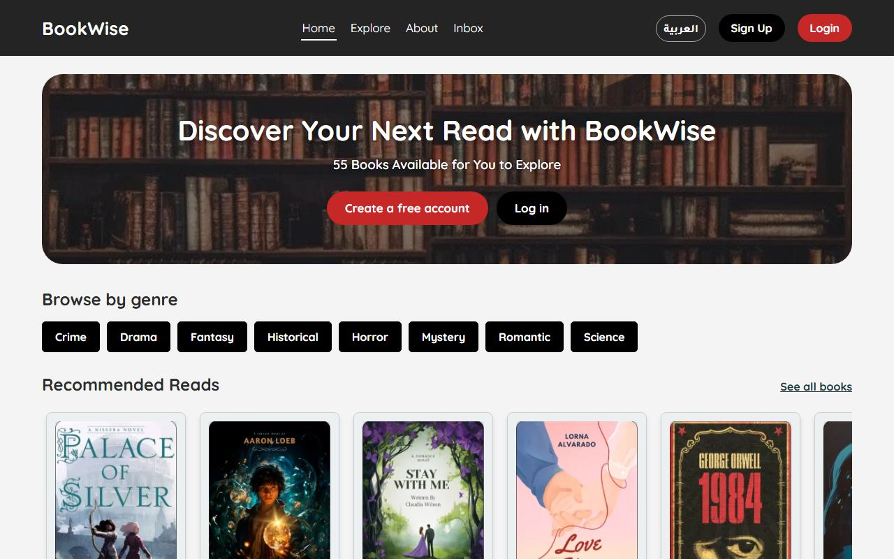</a> | <a href="docs/screenshots/home-ar.jpg"></a> | <a href="docs/screenshots/mobile.jpg"></a> |
| **Home** for a guest | The same page in Arabic | The home page on a phone |
| <a href="docs/screenshots/order.jpg">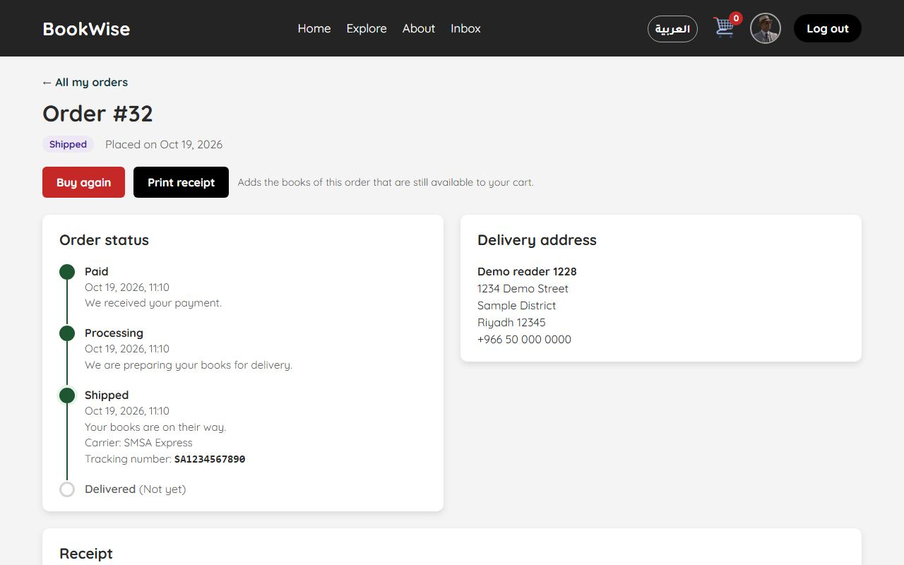</a> | <a href="docs/screenshots/order-ar.jpg">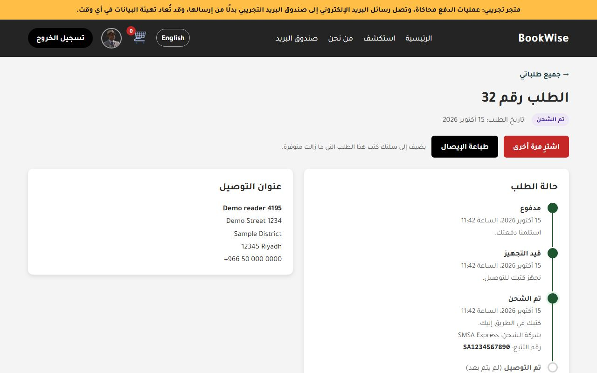</a> | <a href="docs/screenshots/mobile-order-ar.jpg">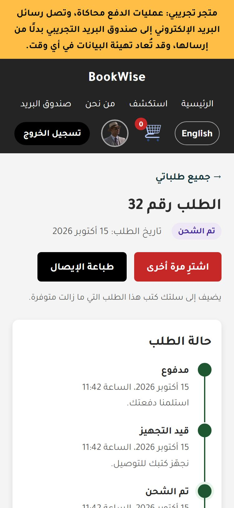</a> |
| **An order**: shipped, with carrier and tracking number | The same order in Arabic | The Arabic order page on a phone |

| | | | |
| :---: | :---: | :---: | :---: |
| <a href="docs/screenshots/explore.jpg">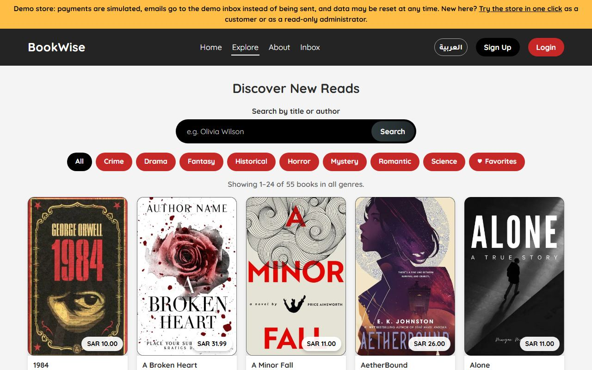</a> | <a href="docs/screenshots/book.jpg">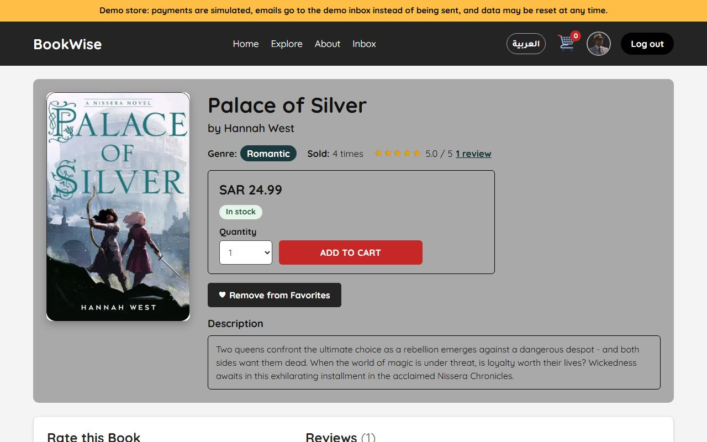</a> | <a href="docs/screenshots/cart.jpg">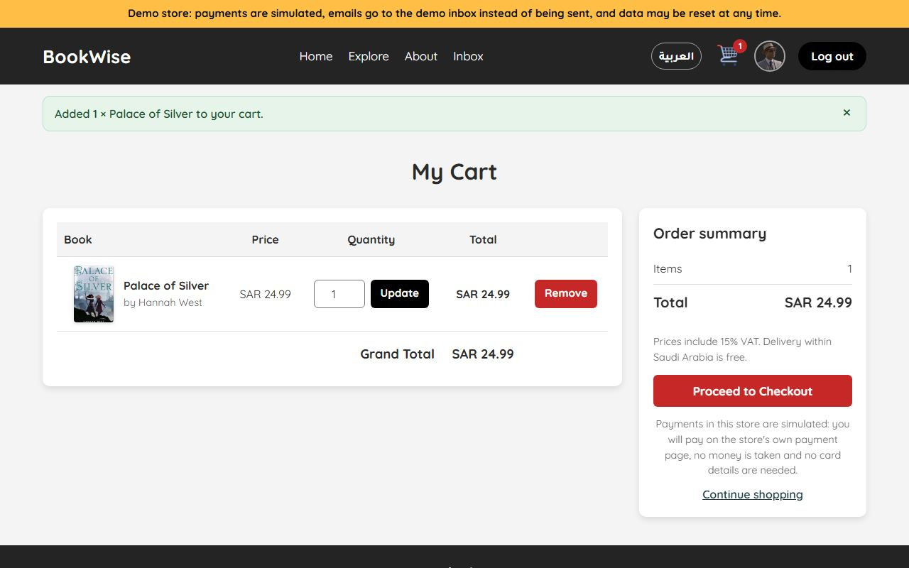</a> | <a href="docs/screenshots/checkout.jpg">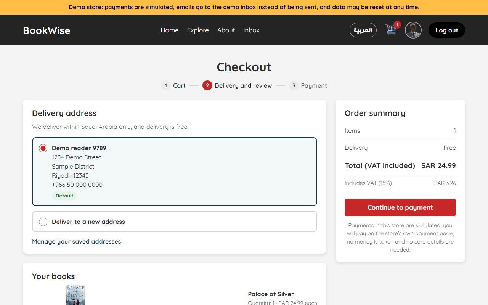</a> |
| **Explore**: search, genres, pages | **Book page**: stock, rating, favorites | **Cart**: totals from catalog prices | **Checkout**: delivery address, VAT |
| <a href="docs/screenshots/payment-simulator.jpg">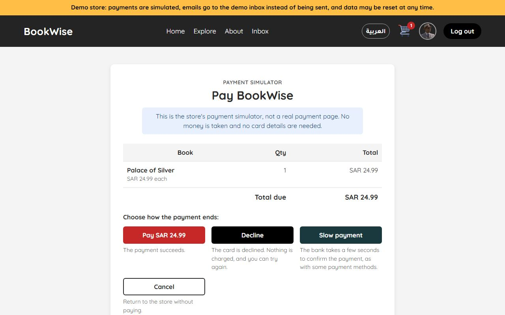</a> | <a href="docs/screenshots/inbox.jpg">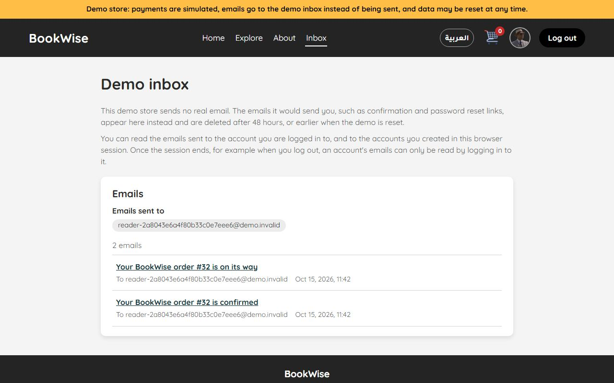</a> | <a href="docs/screenshots/admin-dashboard.jpg">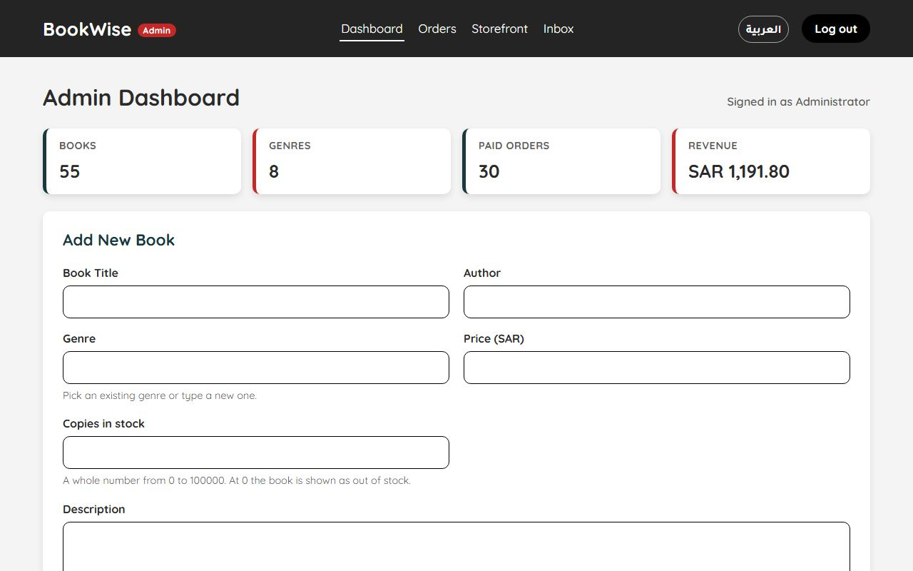</a> | <a href="docs/screenshots/admin-orders.jpg">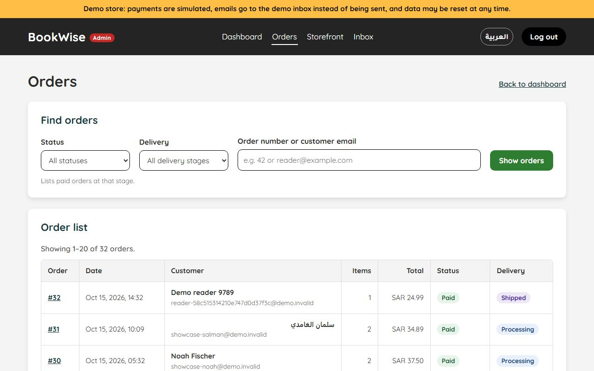</a> |
| **Payment simulator**: four endings, no card details | **Demo inbox**: the store's emails | **Admin dashboard**: totals and the add-book form | **Admin orders**: filters, delivery stages |

## Features

**Customers**

- Browse without an account: the home page with recommended books and best sellers, the Explore page (search by title or author, genre tabs, 24 books per page, with or without JavaScript) and book pages with stock, ratings and reviews.
- Sign up with email verification, reset a forgotten password by email, change the password and delete the account.
- A cart with totals computed on the server, and a checkout page with the delivery address (saved or typed in there and then). Prices include 15% VAT; delivery within Saudi Arabia is free.
- Payment on Stripe's page or the payment simulator's page; an order is confirmed only after the store has verified the payment.
- An order page with the order's progress (paid, processing, shipped with carrier and tracking number, delivered, or refunded), the delivery address, a receipt that prints on its own and **Buy again**.
- Order emails in the account's language: confirmation, shipped, delivered and refunded.
- Favorites, and reviews (1 to 5 stars) of the books the customer bought, which other readers can like or dislike.
- A profile with a picture, the favorite genre, up to five delivery addresses, the order history and the interface language.

**Administrators**

- Add, edit and delete books, with stock levels and cover uploads.
- A dashboard with catalog and sales totals, stock and recent orders; an orders page with filters by status and delivery stage and a search.
- Ship an order (with an optional carrier and tracking number), mark it delivered and refund it in full, at any stage of its delivery. The customer is emailed at each step.
- Two roles: **owners** change everything; **viewers** open every admin page but change nothing, and see customers' details and payment references only shortened. Administrators are created on the command line; there is no public admin sign-up.

**Demo mode** (`APP_DEMO=true`)

- A banner, the payment simulator and, with `MAIL_DRIVER=database`, the demo inbox.
- The one-click demo accounts: demo customers (limited per visitor and in number, deleted after 24 hours) and one shared read-only administrator.
- The showcase of fictional customers, orders and reviews, and a nightly reset (`php bin/demo-reset.php --yes`) that deletes everything visitors did and puts the sample catalog and the showcase back.
- A catalog that visitors cannot sell out: simulated purchases never take a book below 3 copies.

## Engineering highlights

- **Security model.** PDO prepared statements, output escaping and a Content-Security-Policy without inline scripts; CSRF tokens on every state-changing POST; access checks on the server for every page and action; bcrypt passwords with throttled sign-in; reset and confirmation tokens stored only as hashes; uploads re-encoded with GD.
  An order is paid only after the payment has been retrieved from Stripe (or the simulator) and matches the order; webhooks are signed and treated only as notifications. See [the security model](docs/ARCHITECTURE.md#security-model) and [SECURITY.md](SECURITY.md).
- **Tests and CI.** Four PHPUnit suites: unit tests, integration tests against a real database, end-to-end HTTP tests that drive the real pages through `php -S`, and checks of the deployment files and the documentation. Browser tests in Chromium with Playwright cover the main journeys.
  GitHub Actions runs them on PHP 8.3, 8.4 and 8.5 with MySQL 8.4 and MariaDB 11.4, with PHPStan level 8 and `composer audit`, builds and smoke-tests the Docker image, and runs the browser tests against it. Every action is pinned to a commit, and Dependabot proposes updates. See [TESTING.md](docs/TESTING.md).
- **English and Arabic.** Every page, message, email and error page in both languages, with a mirrored right-to-left layout from logical CSS properties, Arabic plural forms, dates and amounts. Unit tests check that both languages have the same keys and placeholders, and that every key the code uses exists.
- **Accessibility checks.** axe-core runs on the main pages in both languages in the browser tests and fails on serious or critical problems; the profile is tested with the keyboard alone; and the HTTP tests check that every page keeps all of its content inside landmarks that can be told apart.
- **Migrations.** `database/schema.sql` installs the latest schema, and numbered migrations (`database/migrations/`) bring existing databases up to date; each checks the schema before it changes it, so it can run again. Tests compare a migrated database with a fresh install.
- **Payment simulator.** The Stripe library's HTTP client is replaced by one that answers inside the same PHP request (`src/payment_simulator.php`), so checkout, payment verification, expiry and refunds run the same code as with Stripe, without a network call, card details or a second server. A real store refuses it.

## Architecture

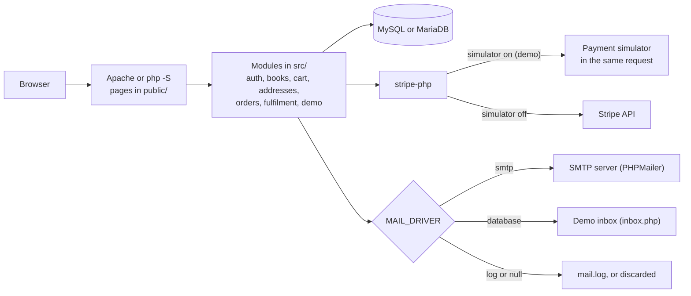

Each page in `public/` loads `src/bootstrap.php` (settings, error handling, session, security headers, language), checks who may see it and calls functions of the modules in `src/`. [docs/ARCHITECTURE.md](docs/ARCHITECTURE.md) describes the request lifecycle, the modules, checkout and payments step by step, deliveries, emails, languages, migrations and demo mode.

## Quick start

**With Docker** (Docker Desktop, or Docker Engine with the Compose plugin):

```bash
git clone https://github.com/ByAhmd/Online-BookStore-Project.git bookwise
cd bookwise
docker compose up --build
```

Open <http://localhost:8080> (only this computer can reach it). The store runs in demo mode with MySQL 8.4, the sample catalog and the showcase. The local owner administrator is `admin@bookwise.test` with the password `local-admin-password`, which is for local use only.
Every release also publishes the image to GitHub Container Registry ([DEPLOYMENT.md](docs/DEPLOYMENT.md#use-a-published-image)).

**With PHP 8.3 or newer** (with `pdo_mysql`, `mbstring`, `curl`, `json`, `fileinfo` and preferably `gd`), [Composer](https://getcomposer.org/) and MySQL 8.0.16+ or MariaDB 10.4+:

```bash
composer install
cp .env.example .env                 # set DB_*, APP_URL=http://localhost:8000 and PAYMENT_SIMULATOR=true
php bin/install.php --seed           # creates the tables and the sample catalog; needs a user that may create tables
php bin/create-admin.php admin@example.com "Store Admin"
php -S localhost:8000 -t public
```

Open <http://localhost:8000>. With `MAIL_DRIVER=log`, the default, the emails (and their confirmation links) are written to `storage/logs/mail.log`.
XAMPP 8.2 bundles PHP 8.2, which cannot run BookWise; XAMPP can still provide the database. [DEPLOYMENT.md](docs/DEPLOYMENT.md#local-setup-without-docker) explains every step, Apache and XAMPP, and the public demo on alwaysdata.

## Documentation

| Guide | Contents |
| --- | --- |
| [docs/CONFIGURATION.md](docs/CONFIGURATION.md) | Every setting (`.env`), payments with the simulator or Stripe, email |
| [docs/ARCHITECTURE.md](docs/ARCHITECTURE.md) | Project structure, request lifecycle, modules, checkout and payments, delivery, emails, languages, migrations, demo mode, security model, known limitations |
| [docs/DEPLOYMENT.md](docs/DEPLOYMENT.md) | Local setup, Docker, the free public demo on alwaysdata, Tailscale Funnel, a real store, the deployment checklist |
| [docs/TESTING.md](docs/TESTING.md) | Quality checks, the PHPUnit suites, the browser tests, CI and the screenshots |
| [docs/AUDIT.md](docs/AUDIT.md) | The audit of the original project, the changes and how they were checked |
| [CONTRIBUTING.md](CONTRIBUTING.md) | Development setup, conventions, commits and releases |
| [SECURITY.md](SECURITY.md) | Reporting a vulnerability |
| [CHANGELOG.md](CHANGELOG.md) | The changes of each version |

## License and credits

The source code is released under the [MIT License](LICENSE).

BookWise started as a team project for the *Fundamentals of Web Programming* course at King Faisal University (see the in-app **About** page).

The book cover artwork in `public/imges/` comes from third parties. It is included only to illustrate this student demo project and is **not** covered by the MIT License; its copyright remains with the respective owners.
