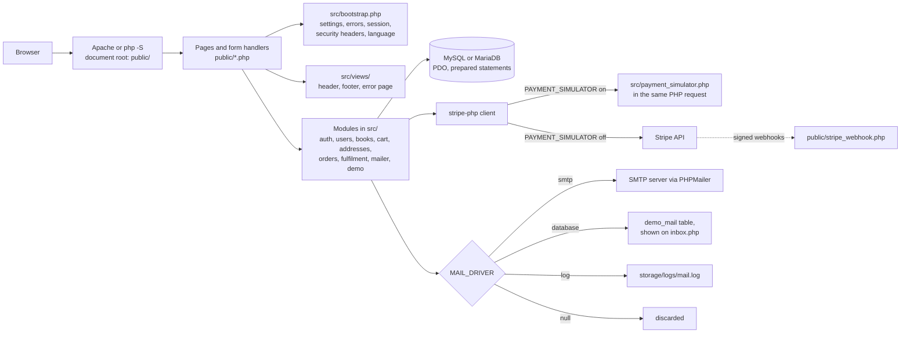
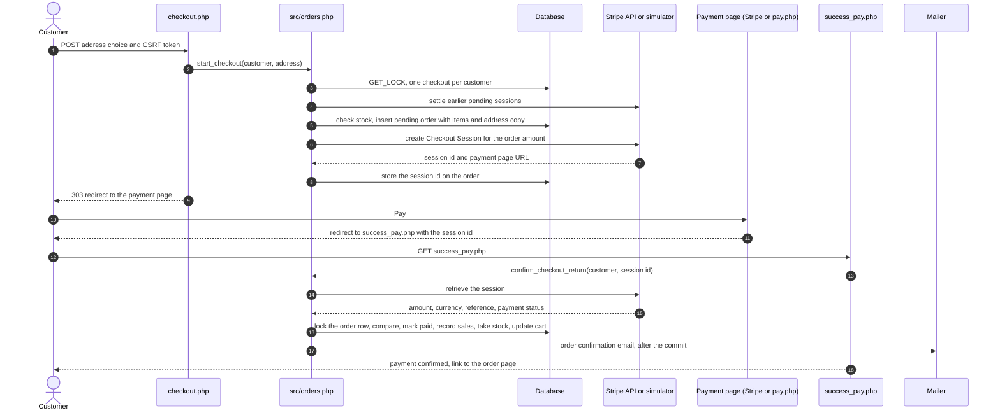

# BookWise architecture

BookWise is plain procedural PHP with MySQL or MariaDB. There is no framework: each page in `public/` is a PHP file that loads `src/bootstrap.php`, checks who may see it, calls functions from the modules in `src/` and prints HTML.
This page describes how the code is organised and how its main features work. Settings are listed in [CONFIGURATION.md](CONFIGURATION.md), hosting in [DEPLOYMENT.md](DEPLOYMENT.md) and the tests in [TESTING.md](TESTING.md).

## Contents

- [Overview](#overview)
- [Project structure](#project-structure)
- [Request lifecycle](#request-lifecycle)
- [Modules](#modules)
- [Pages and scripts](#pages-and-scripts)
- [Accounts, sessions and roles](#accounts-sessions-and-roles)
- [Catalog, cart and reviews](#catalog-cart-and-reviews)
- [Checkout, payments and refunds](#checkout-payments-and-refunds)
- [Delivery and the order page](#delivery-and-the-order-page)
- [Emails](#emails)
- [Languages](#languages)
- [Images and browser caching](#images-and-browser-caching)
- [Database and migrations](#database-and-migrations)
- [Demo mode](#demo-mode)
- [Security model](#security-model)
- [Known limitations](#known-limitations)

## Overview



### Technology stack

| Layer | Technology |
| --- | --- |
| Language | PHP ≥ 8.3 (CI covers 8.3, 8.4 and 8.5; the Docker image and the alwaysdata demo use 8.4) |
| Database | MySQL ≥ 8.0.16 or MariaDB ≥ 10.4 (InnoDB, utf8mb4), accessed with PDO prepared statements |
| Payments | [Stripe Checkout](https://stripe.com/docs/payments/checkout) via `stripe/stripe-php` 22.x, or the built-in [payment simulator](#the-payment-simulator) |
| Email | Any SMTP server through PHPMailer (`phpmailer/phpmailer` 7.x), a [demo inbox](#the-demo-inbox) stored in the database, or a local log file for development |
| Frontend | Server-rendered HTML, plain CSS and vanilla JavaScript (no build step), Google Fonts (Quicksand, Source Sans 3 and, for Arabic, Tajawal) |
| Tooling | Composer, PHPUnit 12, PHPStan 2 (level 8), GitHub Actions; Node.js only for the browser tests (Playwright with axe-core) |

Required PHP extensions: `pdo_mysql`, `mbstring`, `curl`, `json`, `fileinfo`.
`gd` is recommended: it re-encodes uploaded pictures, which strips metadata and embedded payloads, and writes the WebP copies of covers.
`openssl` is needed to send email over SMTP with TLS.

## Project structure

```
.
├── public/                 Web root: point your server's document root here
│   ├── *.php               Pages and form handlers (index.php = login/sign-up, Home_Page.php, Explore_Page.php,
│   │                       checkout.php = delivery and review, order.php = an order's page,
│   │                       pay.php = the payment simulator's page, demo_login.php = the one-click demo accounts, …)
│   ├── css/  js/           Stylesheets and scripts (common.css/common.js are shared)
│   ├── imges/              Catalog covers and UI images (folder name kept: database rows reference it)
│   └── uploads/            Uploaded avatars/ and covers/ (git-ignored, must be writable)
├── src/                    Shared PHP code (autoloaded by Composer)
│   ├── bootstrap.php       Loaded by every page: config, error handling, session, security headers, language
│   ├── auth.php users.php password_reset.php csrf.php validation.php
│   ├── books.php cart.php orders.php   Catalog, stock, cart, Stripe orders and refunds
│   ├── addresses.php fulfilment.php    Delivery addresses; delivery of paid orders, order emails, order page data
│   ├── payment_simulator.php           Built-in stand-in for the Stripe API (demo payments)
│   ├── demo.php            The demo's showcase (fictional customers, orders, reviews) and its daily reset
│   ├── i18n.php            Translations (t(), tn()), Arabic plurals, language switching
│   ├── migrations.php      Schema migration runner
│   ├── db.php env.php helpers.php mailer.php uploads.php
│   └── views/              Shared header (navigation), footer, error page and delivery-address fields
├── lang/en/  lang/ar/      Interface text, one file per area (common, auth, account, shop, admin, mail)
├── database/
│   ├── schema.sql          Latest database schema (fresh installs)
│   ├── seed.sql            Sample catalog: 55 books with stock, no user data
│   └── migrations/         Changes applied to existing databases, in order
├── bin/
│   ├── setup.php           Set up a demo on PHP hosting without Docker (.env, database, administrator)
│   ├── install.php         Create the schema on an empty database, or migrate an existing one
│   ├── migrate.php         Apply pending migrations
│   ├── create-admin.php    Create an administrator (--viewer: read-only) or reset an administrator's password
│   ├── demo-cleanup.php    Delete the one-click demo customers after 24 hours (a daily scheduled task)
│   ├── demo-reset.php      Return the demo to its starting state: showcase, sample catalog, no visitors' data (a daily scheduled task)
│   ├── demo-seed.php       Add the demo's showcase of fictional customers, orders and reviews (once)
│   ├── optimize-images.php Write the WebP copies of the images in public/imges (or of uploaded covers)
│   ├── upgrade-legacy-db.php  Upgrade a database created by the original project
│   ├── release-notes.php   Print a version's section of CHANGELOG.md (used by the release workflow)
│   └── lint.php            `php -l` over the whole project
├── docker/  Dockerfile  docker-compose.yml   Container image and local Compose setup
├── docs/                   CONFIGURATION.md, ARCHITECTURE.md, DEPLOYMENT.md, TESTING.md, AUDIT.md (audit record), screenshots/
├── storage/                logs/ (app.log, php-error.log, mail.log) and the payment simulator's state (git-ignored)
├── tests/                  PHPUnit suites (unit, integration, http, deploy) and an HTTP wrapper around the payment simulator
├── e2e/  package.json  playwright.config.js   Browser tests (Playwright with axe-core) and the README screenshots (Node.js, tests only)
├── .env.example            Configuration template
├── .github/                CI (workflows/ci.yml), releases (workflows/release.yml) and Dependabot (dependabot.yml)
└── CHANGELOG.md  CONTRIBUTING.md  SECURITY.md  LICENSE
```

Only `public/` should be served to browsers; `.env`, `vendor/`, `src/` and the logs live outside it.
This holds when the web server's document root (or alias) is `public/`, as [DEPLOYMENT.md](DEPLOYMENT.md#local-setup-without-docker) describes.
As a safety net for Apache setups that serve the whole folder, the root `.htaccess` denies everything except `public/`.

## Request lifecycle

Every page starts with `require __DIR__ . '/../src/bootstrap.php';`, which:

1. stops with a 503 "BookWise is not installed yet" message if `vendor/autoload.php` is missing, and otherwise loads Composer's autoloader. `composer.json` lists every module of `src/` under `autoload.files`, so all of them are loaded on every request;
2. reads `.env` (`load_env()`) and builds the configuration (`app_config()`, read with `config('db.host')` and so on);
3. sets up error handling (`configure_runtime()`): errors are logged to `php-error.log` and shown only with `APP_DEBUG=true`; warnings and notices become exceptions, deprecations are only logged; an uncaught exception is logged to `app.log` (with the URL's path, never its query string, which can hold single-use tokens) and answered with the translated error page (500);
4. for web requests: buffers the output, so that an error in the middle of a page can still be replaced by a clean error page; starts the session (`start_secure_session()`, skipped by `stripe_webhook.php` and `health.php`, which define `BOOKWISE_NO_SESSION`); sends the security headers (`send_security_headers()`); and handles a `?lang=` language switch (`handle_locale_switch()`), which redirects to the same page without it.

The page itself then:

- **checks access** with `require_user()` (customers), `customer_or_guest()` (pages guests may read), `require_admin()` (any administrator) or `require_admin_write()` (owners only);
- **handles a form** only on POST: `require_post()` answers anything else with 405, and `verify_csrf()` checks the session's CSRF token (419 *Page Expired* when it is missing or wrong). Input is read with `input_string()`, which treats text that is not valid UTF-8 as empty;
- **calls the modules** in `src/`, which use the database through `db_run()`, `db_one()`, `db_all()`, `db_value()` and `db_transaction()`, always with prepared statements;
- **answers a form** with `flash()` and `redirect()` (303 See Other, the Post/Redirect/Get pattern). Invalid input is kept with `remember_input()` and `remember_errors()` and shown next to its field on the next page;
- **renders a page** with `page_header()` (`src/views/header.php`: the document head, the navigation, the demo banner and the flash messages), its own HTML, escaped with `e()`, and `page_footer()` (`src/views/footer.php` and the page's scripts from `public/js`). CSS, scripts and images are linked with `asset()`, which adds a version to the URL ([below](#images-and-browser-caching));
- **stops with an error** through `abort($status)`, which renders the translated error page (`src/views/error.php`). Status 419 is sent with a full status line (`HTTP/1.1 419 Page Expired`), because Apache would otherwise turn a status it does not know into 500.

Paths that do not reach PHP (a missing file, or a path the server denies) get the store's translated 404 or 403 page from `public/not_found.php` in the Docker image (`ErrorDocument` in `docker/apache/site.conf`).

## Modules

| File | What it holds |
| --- | --- |
| `src/bootstrap.php` | The start of every page and script (above) |
| `src/env.php` | `.env` loading and the configuration (`app_config()`, `config()`) |
| `src/helpers.php` | Escaping (`e()`), error handling, logging (`app_log()`), security headers, sessions, requests and redirects, error pages, flash messages, money in minor units, views and `asset()` |
| `src/db.php` | The PDO connection (with optional TLS), query helpers and transactions |
| `src/migrations.php` | Schema inspection and the migration runner |
| `src/csrf.php` | The per-session CSRF token |
| `src/validation.php` | Input rules for emails, names, passwords, dates, genres, ratings and books |
| `src/i18n.php` | The interface languages: `t()`, `tn()`, Arabic plural rules, the language switch |
| `src/auth.php` | Passwords, sign-in and its throttling, sessions of customers and administrators, access checks, administrator roles and the shortened customer details that read-only administrators see |
| `src/users.php` | Customer accounts: sign-up, email verification, profile, language, account deletion and the demo's one-click customers |
| `src/password_reset.php` | Password reset links |
| `src/books.php` | The catalog, search and pages, ratings and sales, favorites, reviews and reactions, book administration |
| `src/cart.php` | Cart lines, quantities and totals |
| `src/addresses.php` | Saudi National Address validation and the customers' address books |
| `src/orders.php` | Orders, Stripe Checkout, payment verification, refunds and webhooks |
| `src/fulfilment.php` | Delivery stages, VAT, the order page's data, **Buy again** and the order emails |
| `src/payment_simulator.php` | The built-in payment simulator |
| `src/mailer.php` | Sending email (log, SMTP, demo inbox, null) and the demo inbox |
| `src/uploads.php` | Uploaded pictures, re-encoding and WebP copies |
| `src/demo.php` | The demo's showcase and its daily reset |
| `src/views/` | The header, footer, error page and delivery-address fields shared by the pages |

## Pages and scripts

| Area | Pages in `public/` |
| --- | --- |
| Accounts | `index.php` (sign-in and sign-up forms, the site's start page), `Register.php` (handles both forms), `verify_email.php` and `resend_verification.php` (email confirmation), `reset_password.php`, `reset_form.php` and `update_password.php` (password reset), `logout.php`, `demo_login.php` (the one-click demo accounts) |
| Shop | `Home_Page.php`, `Explore_Page.php` with `fetch_books.php` (its JSON results), `Selected.php` (a book page with its cart, favorite, review and reaction forms), `About_us.php` |
| Buying | `cart.php`, `update_cart.php`, `delete_from_cart.php`, `checkout.php`, `pay.php` (the payment simulator's page), `success_pay.php` and `cancel_pay.php` (the return from the payment page), `order.php` |
| Customer | `profilePage.php` (profile, language, delivery addresses, payment preference, password, order history, account deletion), `inbox.php` (the demo inbox) |
| Administration | `admin_dashboard.php` (totals, add and delete books, stock, recent orders), `edit_book.php`, `admin_orders.php`, `admin_order.php` (shipping, delivery and refunds) |
| Infrastructure | `stripe_webhook.php`, `health.php` (database check for Docker and uptime monitors), `not_found.php` (the web server's 404 and 403 page) |

The command-line scripts in `bin/` are listed under [Project structure](#project-structure). Each one answers 404 when it is opened through a web server.

## Accounts, sessions and roles

### Customers and guests

- **Guests** browse without an account: the home page, the Explore page (search, genres, pages), book pages and reviews.
  Buying, favorites, reviews and reactions are links such as **Log in to buy** and **Log in to save favorites**; after signing in (or signing up), the visitor is back on the same page.
  The Explore page's **Favorites** tab asks guests to log in.
- **Sign up, log in and log out.** Passwords are hashed with `password_hash()` (bcrypt), failed logins are throttled, and the session ID is regenerated on login. Logging out is a CSRF-protected form.
- **Email verification:** new accounts confirm their address through a link that expires after 24 hours (it can be turned off with `REQUIRE_EMAIL_VERIFICATION=false`).
  The link asks for the account's password before it confirms and signs in, so mail scanners that open links, or someone who registered another person's address, cannot use it.
  Signing up with an address that is already registered sends a notice to that address instead of revealing the account on screen.
  A sign-in on an unconfirmed account gets the same answer as a wrong password, and a fresh link is sent quietly.
- **Password reset** by email, using single-use links that expire after 60 minutes. Completing a reset also confirms the account's email address.
- **Profile:**
  - Name, favorite genre, date of birth and profile picture (JPEG/PNG/GIF/WebP, max 2 MB, re-encoded on upload).
  - A payment-method *preference* (no card data is ever stored).
  - Delivery addresses ([below](#delivery-addresses)): up to five, one of them the default, to add, edit, delete and make the default.
  - Order history with status, delivery stage and refunds, each order linking to its page.
  - Interface language (English or Arabic), remembered on the account.
  - Change password (signs out every other session) and delete the account (asks for the password; past orders are kept anonymously for the store's records, and their delivery addresses are deleted, except for orders still on their way, which keep theirs until they are delivered).
- **Sessions** use HttpOnly, `SameSite=Lax` cookies (plus `Secure` over HTTPS) and expire after 2 hours of inactivity or 24 hours after sign-in. A password change or reset increases the account's `session_version`, which signs out every other session.

### Administrators and roles

- Accounts are created from the command line (`bin/create-admin.php`, or `bin/install.php` with `BOOKWISE_ADMIN_EMAIL` and `BOOKWISE_ADMIN_PASSWORD`, as in containers); there is no public admin sign-up. Administrators sign in on the same form as customers.
  Running `bin/create-admin.php` again for the same email resets that administrator's password, signs out its other sessions and clears any sign-in lockout.
- Two roles (`admins.role`):
  - **owners** (the default) may change everything;
  - **viewers** (`bin/create-admin.php --viewer`) open every admin page but change nothing.
    Running the command again keeps the administrator's role, so resetting a viewer's password never gives it write access. `--owner` or `--viewer` changes the role, and the command says when it changed.
- For a viewer every form is switched off with a note that says why, every admin action that changes something answers 403 (`require_admin_write()`), and customers' names and email addresses are shortened (`S…`, `s…@….com`), so orders are found by their number only (a search never matches inside the addresses).
  Payment references are shortened too (`cs_test_…`): a checkout session id is the key to its payment page.
- What administrators do:
  - add, edit and delete books, with server-side validation, stock levels and cover uploads (JPEG/PNG/GIF/WebP, max 5 MB, re-encoded);
  - follow the dashboard: catalog and sales totals, stock per book and the 20 most recent orders;
  - find orders on the orders page: filter by status and by delivery stage, search by order number or customer email, and open any order;
  - ship, deliver and refund orders on an order's page ([below](#delivery-and-the-order-page)).

## Catalog, cart and reviews

- **Home page:** the real catalog size, genre shortcuts, recommended books (by rating) and best sellers (by sales).
- **Explore page:**
  - Search by title or author.
  - Genre tabs generated from the catalog, plus **Favorites**.
  - 24 books per page with page links.
  - Works without JavaScript; with JavaScript, `explore.js` updates the results in place from `fetch_books.php`, which returns the same data as JSON.
- **Book pages:**
  - Description, price, average rating, copies sold and stock ("Only 3 left", "Out of stock").
  - Add to cart with a quantity, and add to or remove from favorites.
  - Reviews with a 1–5 star rating, only for customers who bought the book and only once per book. Other readers can like or dislike a review. Reviews show the reviewer's name, never the email address.
- **Cart:** change quantities (1–10 per title, never more than in stock), remove items, and see totals computed from catalog prices on the server. A line that asks for more copies than are in stock blocks checkout until it is fixed.

## Checkout, payments and refunds

BookWise sells printed books delivered within Saudi Arabia. Delivery is free, and every price includes 15% VAT.

### The checkout page

The cart's **Proceed to Checkout** button opens `checkout.php`:

1. GET shows the books, the total with the VAT it contains, free delivery, and the delivery address: the saved addresses or **Deliver to a new address**, typed in on the same page. A customer without saved addresses only sees the address form.
   The address chosen at the customer's last checkout in this session is selected again (for example after a payment that could not start because a book sold out, or that was canceled); otherwise the default address is.
2. POST saves a new address in the customer's address book (their first address becomes the default), then starts the payment with `start_checkout()`: the stock is checked, the minimum total applies, one checkout runs at a time per customer, and earlier pending orders are settled first.
   An address that is already saved (the same in every field once normalized) is used again rather than saved a second time, so retyping it or sending the form twice never fills the address book with copies.
   The chosen address must be one of the customer's own. It is read under the checkout lock and copied into the order (`order_addresses`), so editing or deleting the saved address later never changes an order that was already placed.
3. The customer pays on Stripe's page or on the payment simulator's page.

### How a payment becomes an order

`src/orders.php` handles both payment providers the same way: `stripe_client()` returns a `stripe-php` client that talks either to Stripe or, with the payment simulator on, to `src/payment_simulator.php` inside the same request.



1. `checkout.php` copies the cart into a **pending** order, using prices from the database and integer minor units, together with a copy of the delivery address the customer chose.
   It then creates a Checkout Session for exactly that amount, with an idempotency key that is unique to the order row.
   Checkouts are serialised per customer (`GET_LOCK`), so double clicks, two tabs or two devices cannot open two payable sessions.
   Orders below the minimum charge (2.00 in the store currency) are refused before Stripe is called.
2. After payment, `success_pay.php` **retrieves the session from Stripe** (or the simulator) and checks that it belongs to the signed-in customer's order.
   It also checks that the amount, currency and payment status all match.
   Only then is the order marked **paid**, the sales recorded, the copies taken out of stock and the purchased items removed from the cart, in one transaction under a lock on the order row (`fulfill_order()`).
   Opening the success URL without a real payment changes nothing, and reloading it is safe.
   A payment that does not match its order is marked `failed` and logged as `MANUAL REVIEW REQUIRED` in `app.log`.
3. Starting a new checkout first resolves older pending sessions: it expires open ones, fulfils paid ones and marks expired ones.
   A customer therefore can never have two payable sessions for one cart.
4. `cancel_pay.php` changes nothing: the pending order is superseded at the next checkout or expires.

**Webhooks.** With Stripe, signed webhooks confirm payments even if the customer closes the browser before returning (the events are listed in [CONFIGURATION.md](CONFIGURATION.md#stripe-test-mode)).
Every webhook request's signature is verified, and unsigned requests are rejected.
A webhook is treated only as a notification: BookWise re-fetches the Checkout Session (or the refunds) from the Stripe API and acts on that state.
A leaked webhook secret alone therefore cannot mark an unpaid order as paid or a paid order as refunded, and out-of-order deliveries are harmless.
The return page and a webhook can confirm the same payment at the same moment: the lock on the order row makes the change, and the confirmation email, happen once.

**Stock.** Adding to the cart and starting a checkout check the stock. The copies are taken out of stock when the payment is confirmed, and put back when an order is refunded before it is shipped.
Once shipped, the copies have left the store, so a refund does not change the stock; staff add any returned copies on the book's edit page.
Two customers can still pay for the last copy at the same moment; the second order is then recorded and logged as `OVERSOLD` in `app.log` so that staff can restock or refund it.
Each order line records the copies it took (`order_items.stock_taken`), so a refund puts back exactly those.
In demo mode, simulated purchases never take a book below 3 copies.

### Refunds

- A paid order can be refunded in full from its admin page, at any stage of its delivery (`refund_order()`). The Stripe request carries an idempotency key, so a double click never refunds twice.
- Refunds made in the Stripe Dashboard are picked up by the `charge.refunded` webhook, after the refund is confirmed through the Stripe API. Partial refunds are left to staff.
- A refund marks the order **refunded**, removes its sales rows (the books no longer count as sold or reviewable through this order), emails the customer and puts the copies back only if the order had not been shipped.
- When the payment simulator has forgotten a payment (its state file was lost, or the payment is older than 30 days), the refund is recorded in the store only: no money moved in the first place.

### The payment simulator

The simulator (`src/payment_simulator.php`) stands in for the parts of the Stripe API that BookWise uses, so that a demo takes pretend payments without a Stripe account. It never moves real money and never sees card details.

- `stripe_client()` gives `stripe-php` an HTTP client of its own (`PaymentSimulatorHttpClient`), which answers every request in-process with `payment_simulator_api()`. The client's API base is `https://payment-simulator.invalid`, a name that never resolves, so nothing can leave the server. There is no second server and no web-server setup.
- It implements creating, retrieving and expiring Checkout Sessions, and creating, listing and retrieving refunds. As on Stripe, open sessions expire at their `expires_at` (one hour after checkout starts), and a request that repeats an idempotency key gets the first answer again.
- Checkout sends the customer to `pay.php`, the simulator's payment page in the store's own layout (English and Arabic). It shows the books and the total, never asks for card details, and offers four endings:
  **Pay** (paid), **Decline** (a declined card: nothing is charged and the page stays open for another try), **Slow payment** (the payment is confirmed about 15 seconds later, like a delayed payment method) and **Cancel**.
  Like Stripe's page, it needs no store sign-in: the random session id in the link is the key. Its buttons are a form with a CSRF token, and it only redirects to the store's own `APP_URL`.
- Everything else works exactly as with Stripe: the store verifies the payment when the customer returns, expires abandoned sessions at the next checkout and refunds paid orders from the admin order page.
  The simulator sends no webhooks, and `stripe_webhook.php` answers 404 while it is on.
- Its state is a JSON file, `PAYMENT_SIMULATOR_STORE` (default `storage/payment-simulator.json`), read and written under an exclusive lock on a separate `.lock` file and replaced in one step, so concurrent requests never lose each other's changes and a full disk never damages it. It holds no card data and no email addresses, and forgets records after 30 days.
- A real store (`APP_ENV=production` with `APP_DEMO=false`) never uses it, whatever `PAYMENT_SIMULATOR` says: anyone could "pay" for its orders. Checkout then refuses every payment until the setting is fixed.
- The test suites serve the same simulator over HTTP (`tests/Support/stripe_mock_router.php`), so they can record, fail and rewrite Stripe requests.

[DEPLOYMENT.md](DEPLOYMENT.md#the-payment-simulator) describes what each ending of the payment page does and how the state file behaves on a full disk.

### Stripe specifics

- `stripe/stripe-php` 22 sends every request with Stripe API version `2026-09-30.endive`.
  Checkout therefore limits the payment methods to cards with `allowed_payment_method_types`; that version no longer has `payment_method_types`.
- When Stripe adds a notice to an answer (a `Stripe-Notice` header, for example in test mode), it is written to `app.log` as a `Stripe notice` warning and never interrupts a checkout or a refund.
- The store turns off stripe-php's client telemetry. Since version 21 it would keep a random ID in the configuration folder of the user that runs PHP (`~/.config/stripe` or `%APPDATA%\Stripe`), even with the simulator, and send that ID and the operating system's name to Stripe with each request.
- Live keys are accepted only with `APP_ENV=production` and outside demo mode; amounts are sent in integer minor units, so only two-decimal currencies are accepted.

## Delivery and the order page

### Delivery addresses

Customers keep up to five addresses on the **Delivery Addresses** page of their profile, one of them the default. Each is a Saudi National Address:

- the recipient's full name and a Saudi mobile number (typed as `05XXXXXXXX`, `+966 5X XXX XXXX`, `+966 05X XXX XXXX` and so on, stored as `+9665XXXXXXXX`);
- the city, district and street;
- the building number (4 digits), the postal code (5 digits) and, optionally, the additional number (4 digits) and the short address code (4 letters and 4 digits, such as `RRRD2929`).

Digits may also be typed as Arabic-Indic digits (`٠١٢٣`). Every field is checked on the server, and a problem is explained next to its field in the visitor's language.

### Delivery stages

The delivery of an order is tracked separately from its payment status (`orders.fulfilment_status`, `src/fulfilment.php`):

- When the payment is confirmed, the order is **processing**.
- On `admin_order.php`, staff mark it **shipped**, optionally with the carrier (the field suggests carriers common in Saudi Arabia, in the admin's language; the name is stored as typed) and the tracking number, and later **delivered**. Each step happens once and only moves forward; a second click from a page that is out of date changes nothing.
- The orders page filters paid orders by their delivery stage.
- A refund works at any stage. The order then shows as **refunded**, and its delivery is no longer updated.
  Its copies go back into stock only if it had not been shipped: shipped books have left the store, and staff add any that are returned on the book's edit page.
- A second click on **Mark as delivered** from a page that is out of date says why nothing changed: the order was already delivered, was refunded, or has not been shipped yet.
- Orders paid before delivery addresses existed (before migration `006_order_fulfilment`) have no delivery stage.

### The order page

`order.php?id=N` is open only to the customer who placed the order; anyone else gets 404. It shows the order's progress (paid, processing, shipped with carrier and tracking number, delivered, or refunded), the delivery address and a receipt: the books, the total before VAT, the VAT (total × 15/115), free delivery and the total.
Printing the page (also with its **Print receipt** button) prints only the receipt and the delivery address. The receipt is not a tax invoice, because the store has no VAT registration number.
**Buy again** (for paid and refunded orders) puts the order's books back into the cart, as many copies as were ordered within the stock, and names the books that are no longer available.
It is not offered for unpaid orders, whose books are still in the cart: only a confirmed payment takes them out.
The profile's order list, the payment confirmation page and every order email link to the order page.

## Emails

The store sends, in the customer's language: the email-verification (or welcome) email, a notice when someone tries to sign up with an existing address, the password-reset email, a password-changed notice, an account-deleted confirmation and the order emails below.
Every email has a plain-text and an HTML part. `MAIL_DRIVER` decides whether it is written to `mail.log`, sent over SMTP, stored for the demo inbox or discarded ([CONFIGURATION.md](CONFIGURATION.md#email)).

**Order emails.** The customer is emailed in the account's language:

| Email | Sent when |
| --- | --- |
| Order confirmation: the books, the total with its VAT, the delivery address | the payment is confirmed (by the return page, a webhook, or the next checkout) |
| Shipped, with the carrier and tracking number | staff mark the order shipped |
| Delivered | staff mark the order delivered |
| Refunded, with the amount | the order is refunded from its admin page or in the Stripe Dashboard |

Each email is sent by the request that made the change, once that change is committed, and each change happens exactly once: the payment is recorded under a lock on the order row, and every delivery step only moves on from the step before.
The confirmation is therefore sent once even when the return page and a webhook confirm the same payment at the same moment.
As in the account emails, the customer's name and the delivery address appear only once the account's email address is confirmed, because the name of an unconfirmed account may have been typed by someone else.
With the demo inbox (`MAIL_DRIVER=database`), order emails appear in the customer's inbox like every other email.
While the payment simulator takes the payments, the refund email and the order page say that the payment was simulated and no money moved, instead of promising the money back on the customer's statement.
An email that cannot be sent at that moment is logged (`Order email could not be sent` in `app.log`) and not tried again; see [Known limitations](#known-limitations).

### The demo inbox

With `MAIL_DRIVER=database` (only together with `APP_DEMO=true`), emails are stored in the `demo_mail` table instead of being sent, and shown on `inbox.php` (the **Inbox** link in the header).
After 48 hours they are hidden, and deleted the next time an email is stored or the inbox is opened.

- A browser sees only the emails of the account it is logged in to, and of the accounts it created by signing up in the same browser session.
  Signing up with an address that already has an account, or asking for a password reset or a new confirmation link for it, never makes that account's emails readable.
  Nobody can therefore read another person's confirmation or reset links. An administrator sees only the emails sent to their own address.
- A successful sign-up gives the browser a new session ID and CSRF token, as logging in does, so a session ID planted in the browser beforehand cannot read the new account's emails.
  Access to an account created this way ends with the session (see [Known limitations](#known-limitations)).
- Deleting an account deletes its emails. Emails to an address without an account, such as the account-deleted notice, are not stored, because nobody could read them.
  Emails left over for an address without an account are also removed before the address is registered again.
- Emails are shown as plain text, in their own language and text direction. Only links to the store (`APP_URL`) are clickable; the HTML part is stored but never displayed. The page is sent with `Cache-Control: no-store`.
- The demo banner and the notes on the password reset and confirmation pages point to the inbox.
- The one-click demo customers have made-up addresses at the reserved `demo.invalid` domain: their emails appear in the demo inbox (or `mail.log`), and are never sent over SMTP.
  Nobody can sign up with, or ask for links to, an address at that domain.

## Languages

Every page, form message, email and error page is available in English and Arabic.

- Visitors switch language with the link in the header (`?lang=ar` / `?lang=en`). The choice is kept in a cookie and, for signed-in customers, on the account, so emails arrive in the same language.
- Arabic pages use `dir="rtl"`, the Tajawal font, Arabic plural forms (zero, one, two, few, many, other), Arabic month names and amounts written as `19.99 ر.س`.
  The stylesheets use logical CSS properties (`margin-inline-start` and so on), so the layout mirrors without separate RTL files.
- Catalog content (titles, authors, descriptions) is shown as entered. Common genre names are translated (`shop.genres` in `lang/<language>/shop.php`); other genres appear as stored.
- Text lives in `lang/<language>/<area>.php` and is looked up with `t('shop.cart.title')`, or `tn('shop.book.sold_times', $count)` for plurals.
  Placeholders such as `:title` are escaped when the text is printed.
- To add a language, copy `lang/en/` to the new code, translate the files, and add the code to `SUPPORTED_LOCALES` in `src/i18n.php` (and to `RTL_LOCALES` if it is written right to left).
  The unit tests check that every language defines the same keys and placeholders, and that every key the code uses exists in both languages.

## Images and browser caching

The catalog covers in `public/imges` are 380×605 PNG files of about 330 KB each. `bin/optimize-images.php` writes WebP copies next to every PNG, JPEG and GIF there:
a full-size `.webp` (about a tenth of the size) and, for images wider than 190 pixels, a `-w190.webp` thumbnail for book cards, the cart and admin tables.
Pages show covers with `cover_picture()`: a `<picture>` whose `<source>` offers the WebP copies (`srcset` with their widths, and the `sizes` the page displays them at), with the original as the `` for browsers without WebP.
`fetch_books.php` returns the same sources (`cover_image`, `cover_webp_srcset`), so the Explore page's script builds the same markup.
Uploaded covers get their copies when they are uploaded (the larger copy at most 780 pixels wide, which also bounds the memory GD needs; a WebP upload is its own full-size copy, and one wider than that is offered as a `-w780.webp` copy), and the copies are deleted with the cover when it is replaced or its book is deleted.
The copies are never a book's cover: the admin form refuses their paths and asks for the original image.

```bash
php bin/optimize-images.php                  # after adding or changing images in public/imges; commit the .webp files
php bin/optimize-images.php uploads/covers   # once, for covers uploaded before WebP copies existed
php bin/optimize-images.php --force          # rewrite every copy, e.g. after changing WEBP_QUALITY
```

The script needs `gd` with WebP support and skips copies that are at least as new as their image, so it can be run again at any time.
A unit test fails when an image in `public/imges` has no copy, or a copy that no longer shows it: git does not keep file times, so the test compares both pictures reduced to 8×8 cells.

Pages link their CSS, scripts and images with `asset()`, which adds `?v=<file modification time>`, so a changed file gets a new URL.
`public/.htaccess` (and `docker/apache/site.conf` in the Docker image) therefore let browsers keep versioned URLs for a year (`Cache-Control: public, max-age=31536000, immutable`).
Uploads are kept for an hour, and other static files, such as images referenced from CSS, for a day. HTML pages are never cached: PHP sends `Cache-Control: no-store`.
These rules need Apache's `mod_headers`; without it, `mod_expires` keeps every static file for an hour. Servers that ignore `.htaccess` (nginx, `php -S`) need the same headers in their own configuration.

## Database and migrations

`database/schema.sql` always describes the latest schema, and `database/seed.sql` holds the sample catalog (55 books with stock, no user data). The tables:

| Tables | What they hold |
| --- | --- |
| `users`, `admins` | Customers (with their language, confirmation time and `session_version`) and administrators (with their role) |
| `email_verifications`, `reset_tokens`, `login_attempts` | Confirmation and reset links (SHA-256 hashes only) and failed sign-ins for throttling |
| `books`, `favorites`, `comments`, `comment_interactions` | The catalog with its stock, favorites, reviews and their likes and dislikes |
| `cart`, `addresses` | Cart lines and saved delivery addresses |
| `orders`, `order_items`, `order_addresses`, `sales` | Orders with their payment and delivery state, their lines, the address copy and the sales of paid orders |
| `demo_mail`, `demo_guest_creations` | The demo inbox and the rate limit of the one-click demo customers |
| `schema_migrations` | The migrations a database has |

Changes for existing databases live in `database/migrations/` and are recorded in the `schema_migrations` table:

| Migration | Change |
| --- | --- |
| `001_initial` | The first published schema (recorded, no file) |
| `002_accounts_commerce_i18n` | Email verification, account language, stock tracking, refunds, and orders that are kept (anonymised) when a customer deletes their account |
| `003_order_stock_taken` | `order_items.stock_taken`: how many copies each line took out of stock |
| `004_demo_mail` | The demo inbox |
| `005_admin_roles` | Administrator roles and the one-click demo customers |
| `006_order_fulfilment` | Delivery addresses, the address copy of each order, and delivery stages with carrier and tracking number |

```bash
php bin/migrate.php        # apply pending migrations (safe to run repeatedly)
php bin/install.php        # the same on an existing database; creates the schema on an empty one
```

A migration file returns `static function (PDO $pdo): void { … }` and is applied in name order. MySQL commits schema changes at once, so every migration checks the current schema before it changes it and can run again safely.
Back up the database first (`mysqldump`), and run the command with an account that may alter tables.
Databases created before migrations existed are recognised automatically and treated as being at version `001_initial`.
`bin/install.php` refuses a partly installed database (an interrupted first installation) with a message instead of guessing.
The integration tests (`tests/Integration/MigrationsTest.php`) take tables back to their older form, apply the newer migrations and compare the result with a fresh install from `schema.sql`.

### Upgrading a database from the original project

The original project used a database named `signup` with MD5 passwords and fewer constraints.
To keep its accounts, books, carts, favorites, reviews and sales:

```bash
mysqldump -u root -p signup > ../signup-backup.sql   # back up first, outside the project folder
# point DB_NAME at that database in .env, then:
php bin/upgrade-legacy-db.php --i-have-a-backup
```

Keep database dumps out of the repository; `*.sql` files other than `database/schema.sql` and `database/seed.sql` are git-ignored as a safety net.

The script is idempotent: each step is skipped if it has already been applied. It:

- Widens the password columns and drops the stored "confirm password" column.
- Adds the `session_version` columns used to sign out other sessions after a password change.
- Adds unique keys, merging duplicate cart lines, favorites, reviews and review reactions first.
- Clamps legacy ratings to the range 1–5.
- Deletes old plaintext reset tokens.
- Clears free-text payment-method entries, which could contain card numbers.
- Creates the `orders`, `order_items` and `login_attempts` tables.
- Recreates all foreign keys with the documented `ON DELETE` rules, then applies the regular migrations.

Existing MD5 passwords keep working and are re-hashed with bcrypt the next time each user logs in.

## Demo mode

`APP_DEMO=true` turns a store into a public showcase ([DEPLOYMENT.md](DEPLOYMENT.md) shows how to run one):

- A banner on every page says that payments are simulated, that data may be reset and, with the demo inbox, that emails go there. Visitors who are not signed in are pointed to the one-click demo accounts.
- The [payment simulator](#the-payment-simulator) takes the payments (unless `PAYMENT_SIMULATOR=false`). A live Stripe key is never used.
- The [demo inbox](#the-demo-inbox) can show the store's emails (`MAIL_DRIVER=database`).
- The stock is topped up at every `bin/install.php` (and so at every container start), and simulated purchases never take a book below 3 copies, so visitors cannot sell the shared catalog out.

### One-click demo accounts

Only in demo mode, the sign-in page offers two buttons (`demo_login.php`, which answers 404 without `APP_DEMO=true`; both are POST forms with a CSRF token), and the banner links to them for visitors who are not signed in:

- **Try as a customer** creates a fresh account for that visitor ("Demo reader 4821", a random address at the reserved `demo.invalid` domain, a random password nobody knows, already confirmed, with a few favorites and a made-up delivery address in Riyadh) and signs it in, so the visitor can check out at once.
  It can use the whole store (cart, simulated checkout, reviews of the books it bought, the demo inbox) and delete itself, but it has no password to change or reset.
  One visitor (an IPv4 address, or an IPv6 /64 network) may create 10 per hour and all visitors together 60 per hour, and at most 200 exist at once (the oldest are deleted, with their data, to make room).
  `php bin/demo-cleanup.php` deletes them after 24 hours, with their carts, favorites, reviews and abandoned checkouts; paid orders are kept, anonymised, as when customers delete their accounts.
- **Try as an administrator (read-only)** signs in to a shared [viewer](#administrators-and-roles) administrator, created on first use with a random password nobody knows.

### The showcase and the daily reset

A demo that starts empty has no best sellers, no ratings and nothing on the admin dashboard. In demo mode BookWise therefore adds a **showcase** once (`src/demo.php`):

- 12 clearly fictional customers, six with English and six with Arabic names. Their addresses are at the reserved `demo.invalid` domain (`showcase-maya@demo.invalid`, …) and their passwords are random and thrown away, so nobody can sign in to them; each has a made-up Saudi delivery address.
- 31 orders over the last 60 days: paid ones at every stage of delivery (processing, shipped with a carrier and tracking number, delivered), one refunded before it was shipped and one abandoned checkout.
  They follow the store's own rules: delivery-address copies, catalog prices with VAT, sales rows for paid orders, and copies taken out of stock (never below 3).
- 32 reviews (3 to 5 stars, in the customer's language) by customers who received the book, with likes and dislikes by the others, and favorites.

`php bin/install.php` adds it in demo mode when the store has none yet (so `php bin/setup.php` and the container do too; `--no-showcase` leaves it out), and `php bin/demo-seed.php` adds it by hand. Running either again adds nothing.

`php bin/demo-reset.php --yes` returns a demo to that starting state. It deletes every customer with their data and orders (every other order too), the demo inbox, the one-click demo customers' records, the books administrators added and the uploaded pictures, puts the 55 sample books back as `database/seed.sql` has them, empties the payment simulator's state and adds the showcase again.
Administrators are kept. The database part is one transaction, so visitors never see a half-reset store. Without `--yes` it changes nothing, and both commands refuse to run outside demo mode.
With `--no-showcase` it leaves the showcase out, which empties a demo of every customer and order before it becomes a real store ([DEPLOYMENT.md](DEPLOYMENT.md#d-a-real-store-stripe-payments-and-email), step 8).
On alwaysdata it runs every night as a scheduled task, next to `php bin/demo-cleanup.php`. [DEPLOYMENT.md](DEPLOYMENT.md#schedule-the-daily-reset-and-the-cleanup) has the exact task settings for 04:00 Riyadh time, and shows how to check the time zone of alwaysdata's scheduler first: alwaysdata does not document it, and the settings assume UTC.
[DEPLOYMENT.md](DEPLOYMENT.md#the-showcase-and-the-daily-reset) describes both in more detail, with the output of a reset.

## Security model

- **SQL injection:** all queries use PDO prepared statements with native binding.
- **XSS:** all output is escaped with `e()`. A Content-Security-Policy allows only same-origin scripts; there are no inline scripts or event-handler attributes.
- **CSRF:** every state-changing request is a POST with a per-session CSRF token. The Stripe webhook is authenticated by its signature instead.
- **Sessions:** HttpOnly, `SameSite=Lax` cookies (plus `Secure` when served over HTTPS), strict mode and ID regeneration on login.
  Sessions expire after 2 hours of inactivity or 24 hours after sign-in, and a password change signs out every other session.
- **Access control:** customer and admin checks are enforced on the server for every page and action.
  Cart lines, delivery addresses, orders, order pages and payment returns are always scoped to the signed-in user; a checkout accepts only one of the customer's own addresses.
  Guests may only read the catalog and book pages. Every admin request that changes something (book forms, cover uploads, deletions, shipping, refunds) requires an owner (`require_admin_write()`): read-only administrators get 403.
- **Payments:** an order is paid only after the session has been retrieved from Stripe (or the simulator) and its order reference, amount, currency and payment status match; webhooks are only notifications (see [above](#how-a-payment-becomes-an-order)). Live Stripe keys are refused outside `APP_ENV=production` and in demo mode, and a real store refuses the payment simulator.
- **Demo accounts:** only in demo mode, through POST forms with a CSRF token. Demo customers get random, unguessable addresses and passwords that nobody knows; they cannot set a password (no password change, no reset link), and their creation is limited per IPv4 address or IPv6 /64 network, for all visitors together, and in number.
  The shared demo administrator is always a viewer, and sees customers' names, email addresses and payment references only shortened.
  In particular it never sees a checkout session id, which would let anyone finish that customer's payment on the simulator's page (`pay.php` needs no sign-in, like Stripe's).
- **Passwords:** bcrypt via `password_hash()`, with a transparent upgrade of legacy MD5 hashes.
  Sign-in performs one hash verification per attempt, so response times don't reveal which accounts exist.
  Login is throttled after 5 failures for one email from one IP address, 20 failures from one IP, or 100 failures for one email from anywhere, within 15 minutes.
  Attackers elsewhere therefore cannot lock the real owner out.
  `bin/create-admin.php` clears an administrator's lockout.
- **Password-reset and email-verification tokens:** 256-bit random, stored only as SHA-256 hashes, single use, expiring after 60 minutes (reset) or 24 hours (verification).
  Opening a link only shows a form; the token is used when the form is submitted (with the new password, or the account's password for a confirmation).
  Reset requests, sign-ups, verification resends and sign-in attempts on unconfirmed accounts do not reveal whether an account exists.
  Emails greet the customer by name only once the address is confirmed, because the name of an unconfirmed account may have been typed by someone else.
- **Account changes:** changing the password or deleting the account requires the current password, and both sign out every other session.
- **Uploads:**
  - The type is detected from the file contents, and only images up to 2 MB (avatars) or 5 MB (covers) and 4000×4000 pixels are accepted.
  - Files get random names and are re-encoded with GD, so only decoded pixels are stored.
  - `public/uploads/.htaccess` prevents script execution on Apache.
- **Input encoding:** text that is not valid UTF-8 is rejected as empty input rather than reaching the database.
- **Demo inbox:** a browser reads only the emails of the account it is logged in to and of the accounts it created by signing up; typing an address into a form never shows its emails (see [The demo inbox](#the-demo-inbox)).
  Signing up renews the session ID, as logging in does. Messages are escaped, link only to the store, and are sent with `Cache-Control: no-store`.
- **Logs:** unhandled errors are logged with the URL's path only, so single-use tokens in query strings stay out of `app.log`, and the Docker image's access log leaves out query strings too. The SMTP password is never logged, and the container's start-up output never shows `DB_PASS`.
- **Secrets:** read only from the environment. `.env` is git-ignored, and `.env.example` contains placeholders only.
- **Headers:** `X-Frame-Options: DENY`, `X-Content-Type-Options: nosniff`, `Referrer-Policy`, `Permissions-Policy` and HSTS when served over HTTPS.

The hosting side (serving only `public/`, database rights, TLS, proxies) is covered by the [deployment checklist](DEPLOYMENT.md#deployment-checklist) and the [security notes](DEPLOYMENT.md#security-notes) of the deployment guide. How to report a vulnerability is in [SECURITY.md](../SECURITY.md), with the [credential rotation](../SECURITY.md#credential-rotation) note about the original project's keys.

## Known limitations

- **Stock is not reserved during checkout:** it is taken when the payment is confirmed, so two simultaneous payments for the last copy can oversell it (logged as `OVERSOLD`).
- **Single currency:** prices are stored without a currency and charged in `STRIPE_CURRENCY` (SAR by default).
- **Delivery only within Saudi Arabia, always free:** there is no shipping-cost calculation, no delivery zones or dates, and an order is always one parcel.
- **Addresses are checked for their format only:** they are not looked up in Saudi Post's National Address register. The carrier and tracking number are plain text: there is no link to the carrier's tracking page and no automatic status update; staff mark orders shipped and delivered by hand.
- **Order emails are not retried:** each is sent once, by the request that made the change. If the mail server fails at that moment, the failure is logged and that email is never sent; the order page always shows the current state.
- **Receipts, not tax invoices:** prices include 15% VAT, but the store has no VAT registration number, so it issues receipts rather than tax invoices.
- **Orders cannot be changed or canceled by customers** once they are paid; staff refund them instead.
- **Limited account self-service:** customers cannot change their email address or export their data. Administrators cannot manage customers from the UI.
- **Refunds are full refunds only.** Partial refunds and disputes are handled in the Stripe Dashboard and are not reflected in orders.
  A payment that does not match its order is marked `failed` and logged as `MANUAL REVIEW REQUIRED` in `app.log`.
- **Login throttling** counts attempts per IP address. Behind a reverse proxy, every client shares the proxy's address unless `REMOTE_ADDR` is set correctly by the server.
  The Docker image takes the address from `X-Forwarded-For` on connections from private addresses; on alwaysdata this was not confirmed (see [DEPLOYMENT.md](DEPLOYMENT.md#step-9-check-the-visitors-addresses) for a check).
- **No sign-up rate limit:** only verification and sign-up notice emails are limited, to one per account every few minutes.
- **Sign-up reveals registered addresses when email verification is off** (`REQUIRE_EMAIL_VERIFICATION=false`, as in `docker-compose.yml` and the browser tests' local store): the form then answers "An account with this email already exists." With verification on, the default, it gives the same answer either way.
- **Demo accounts:**
  - Demo customers are limited per visitor (10 per hour for an IPv4 address or an IPv6 /64 network), with the same caveat as login throttling behind a proxy: if every visitor shares the proxy's address, they share the limit too.
  - Someone with many addresses can still use up the limit for all visitors (60 per hour). Nobody can then start a demo customer until the hour is over, but existing demo customers are not pushed out faster than that.
  - At most 200 demo customers exist at once. On a busy demo the oldest are deleted to make room, so a visitor's demo account can disappear before its 24 hours are over.
  - They are deleted by the nightly reset, or after 24 hours when `php bin/demo-cleanup.php` runs (both daily scheduled tasks, see [DEPLOYMENT.md](DEPLOYMENT.md#schedule-the-daily-reset-and-the-cleanup)); for the cleanup, a checkout still being confirmed delays it to the next run.
  - Every visitor who presses **Try as an administrator** shares the same read-only account, and sees every order of the demo (with shortened customer details and payment references).
- **The demo inbox reveals registered addresses:** after signing up, a confirmation email appears in the browser's inbox only when the address was new.
  The sign-up page itself still gives the same answer either way. This only applies to a demo with `MAIL_DRIVER=database`, which holds no real accounts.
- **Demo inbox access to a new account ends with the browser session:** without logging in, an account's emails can only be read in the browser session that created it.
  Once that session ends (logging out, closing the browser or 2 hours of inactivity), a forgotten password cannot be reset from the demo.
  An account that was never confirmed cannot be confirmed any more, and its address stays taken until the next nightly reset.
  This follows from the rule that nobody may read another person's emails.
- **The demo's showcase is fixed:** its customers, orders and reviews are the same every day (only their dates move), and the nightly reset deletes everything visitors and administrators did, books added by administrators included. Its scheduled time depends on the time zone of alwaysdata's scheduler, which has to be checked (see [DEPLOYMENT.md](DEPLOYMENT.md#schedule-the-daily-reset-and-the-cleanup)).
- **The free live demo** on alwaysdata has 1 GB of disk space, shows its emails in the demo inbox instead of sending them, and its first request after 30 idle minutes is slower. See [DEPLOYMENT.md](DEPLOYMENT.md#limits-of-the-free-demo).
- **The original database could not be fully recovered:** the original repository shipped raw MariaDB data files instead of an SQL export.
  The table definitions and the 55-book catalog were recovered from them and form `schema.sql`/`seed.sql`.
  The original foreign-key definitions could not be recovered (they lived in the missing InnoDB system tablespace).
  They were re-specified from how the application uses the data ([AUDIT.md](AUDIT.md#2-database-recovery)).
